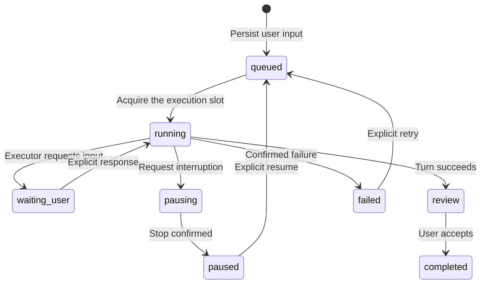
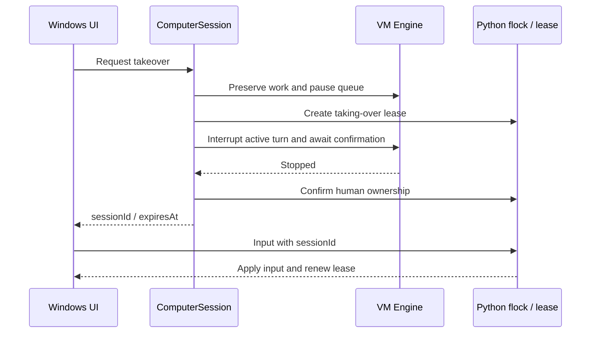

# dant Windows architecture

English · [简体中文](zh-CN/architecture.md)

This implementation follows the supplied Mac/UTM architecture and 15 reference screens. Windows substitutes Hyper-V, AMD64 Ubuntu, OpenSSH, and a native desktop host while preserving responsibility boundaries.

## Modes and data ownership

| Mode | Responsibility |
| --- | --- |
| `--prepare` | UI and setup preparation; no automatic VM connection or model execution. |
| Default / `--vm-controller` | Hyper-V setup, deployment, Windows notifications, offline cache, and API forwarding. |
| `--vm-worker` | Ordinary VM user owning Engine, Store, Codex, attachments, memory, and desktop control. |
| `--deploy-worker` | Deploy or update the Worker without starting a local UI. |

The Controller never constructs a task Engine or executes agent work on Windows. The Worker checks for a Linux VM, an ordinary user, and a healthy graphical desktop at startup. Both HTTP services bind only to their own loopback address. The VM API is not exposed on its virtual network adapter; files cross controlled interfaces rather than shared host directories.

Windows stores `controller.json`, `vm.json`, deployment and migration receipts, notification state, an optional encrypted API key, and `state-cache.json`. The cache is for offline display, not another conversation authority. A disconnection retains the last known conversation and local draft, but work fails explicitly rather than executing on the host.

Language and appearance belong to the Controller and can change offline. Semantic CSS colors and native window theme stay in sync. Fonts include Chinese and English fallbacks; VM screenshots retain original colors. Valid connection directories used by this Windows user enter a local profile registry. An unconfigured installation may import a single valid source automatically; multiple sources require selection. Import saves connection information only, preserves existing valid bindings, and leaves keys, disks, and authentication at their original locations.

The VM owns `~/dant/data/state.json`, immutable UUID attachment files and metadata, and `memory/dant/`. Work runs under `~/dant/workspaces/<conversationId>/output/`. Initial migration backs up original Windows data and converts attachment references without copying Codex authentication. Deployment uses a source allowlist, retains data and release backups, and defers updates during active work or calls.

## Persistent conversation and execution

A permanent UUID identifies the conversation, workspace, and reused Codex thread. User receipt is saved before execution. Only a valid `turn/start` acknowledgment establishes executor confirmation. Early events are bounded by count and size and replayed only after matching the acknowledged turn.

Review, completion, and reading are separate. An assistant message is read only after remaining in the viewport of a visible, focused page for about 450 ms. A successful ordinary turn creates a Completion record; Windows waits three seconds before checking unread state and displaying a fixed-content notification.

Steering is serialized against an acknowledged `expectedTurnId`; requests arriving before startup acknowledgment wait. Uncertain submissions pause without automatic replay. Restart recovery pauses queued, running, stopping, or input-waiting tasks so external actions are not repeated unintentionally.

## Files and memory

Messages allow at most five attachments of 10 MiB each. Content inspection determines media type. UUID storage prevents client filenames or declared MIME types from controlling paths. Active HTML/SVG downloads instead of rendering; remote images are not loaded automatically, and incoming audio never autoplays.

Before a turn, the engine computes a SHA-256 baseline of `output/`. Successful turns archive new or changed eligible files; explicitly referenced existing files may be delivered again. Delivery stores an independent copy. Scanning is bounded to 512 entries, 64 MiB, and eight levels, and rejects symlinks, multiple hardlinks, secret-like names, and logs. Linux scanning anchors paths to directory descriptors and verifies identity and metadata before and after reading.

Memory consists of `README.md`, `identity.md`, and `working-memory.md`, limited to 64 KiB per file and 12,000 context characters. Basic credential redaction and delimiter escaping treat notes as reference data rather than new permission. This memory is independent of ChatGPT cloud memory.

## Desktop ownership

Model tools and human input share `flock` and the control file. Unconfirmed interruption never grants input access. Stale session IDs, unconfirmed leases, and expired leases are rejected. Two idle minutes release ownership; paused tasks require explicit resumption afterward. The visible computer panel fetches screenshots serially and maps input to actual image bounds.

Calls and acquiring human desktop control are mutually exclusive. The UI disables takeover during an active or recovering call and while hangup is unconfirmed; the Worker also enforces this rule. Desktop viewing remains available, and releasing an existing human lease is never blocked by that UI check. No takeover action automatically ends a call.

These constraints cover app scheduling and desktop tools. They cannot guarantee termination of previously detached background processes or replace VM operating-system permissions.

## Voice

The default subscription channel uses `thread/realtime/start`, V3, `gpt-live-1-codex`, and WebRTC. The frontend owns audio tracks and the `oai-events` data channel; Controller and Worker carry negotiation and work control. Call records begin only after actual media connection confirmation, not after SDP alone.

Calls share the conversation thread and workspace. Explicit messages and files are saved; ordinary spoken narration and transcripts are not persisted as chat. Stopping handles both audio and delegated work. An uncertain stop requires confirmed executor termination rather than releasing ownership just because audio ended.

During a subscription call, `thread/realtime/appendText` supplies typed-text visibility and reaction updates to that same realtime session. Reaction removal is an update too; feedback includes its referenced message and does not enqueue ordinary work. Explicit typed messages retain their stable identifier and existing persisted task submission; the live update must not submit a duplicate task. RPC acknowledgment establishes only submission, not a model read receipt or proof of understanding. The model may speak an acknowledgment. Unknown delivery is not automatically replayed.

Model-selected reactions to user messages use a VM tool and persist as `assistantReaction` / `assistantReactionUpdatedAt`, separately from human `reactions`. The UI labels dant's badge and does not offer a human toggle for it. The same emoji can belong to both parties independently; assistant-owned feedback is not treated as human feedback. The UI never guesses a reaction from message text.

Minimizing or expanding changes only the call view. It preserves the peer connection, media, call identifier, and elapsed-time clock. The clock begins at the confirmed connection timestamp, freezes on local disconnection or hangup, and reconciles its final value with the saved call record.

The optional API channel is selected explicitly and has separate API billing. Its key persists only under Windows DPAPI and reaches VM call-process memory transiently over SSH. Dictation, browser read-aloud, and local WAV creation are separate helper paths.

The composer microphone records a WebM or Ogg voice-message file, previews the uploaded attachment without autoplay and waits for explicit Send. Cancellation or recording failure discards its audio and releases microphone tracks. Speech to text is an explicit attachment-menu action. Recorded audio stays a file reference in ordinary task input; there is no automatic transcription or guarantee of model audio understanding.

## Telegram

The gateway runs with the VM Worker and is disabled by default. Fixed HTTPS Bot API endpoints provide outbound long polling without a public inbound port. A short-lived one-time pairing code binds both private-chat ID and user ID. Groups and unpaired users cannot submit tasks.

Telegram inputs have stable external IDs and use the same Store and serial Engine. Only completed messages and controlled attachments belonging to that Telegram task return to its owner. Other desktop tasks and historical messages are not broadcast.

The Bot Token stays in a separate restricted VM data file, never a state snapshot, offline cache, memory note, or chat. Unconfirmed outbound results are recorded without blind replay. Poll offsets and deduplication survive restart; previously paused tasks do not resume automatically. See [Telegram setup](TELEGRAM.md).

## Platform differences and verification boundaries

The Windows rebuild retains Express, WebSocket, and Vite dependencies instead of recreating the prototype's zero-npm network stack. Browsers prefer SSE; desktop JSON calls use Rust IPC, with the next state poll about 700 ms after the previous finishes. The Controller merges VM state reads using a two-second cache. Failed business mutations are not automatically resent.

Unit tests use isolated directories, injected executors, and loopback fixtures to verify receipts, uncertainty, migration, archival, leases, transports, themes, and Telegram behavior. Real VM model replies, desktop operations, file delivery, and silent V3 WebRTC have separate acceptance records. Microphones, speakers, continuous interruption, visual UI checks, and native notification banners must not be inferred from protocol tests.
