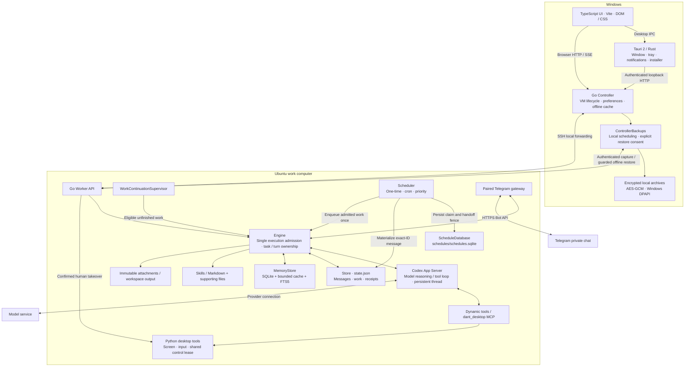
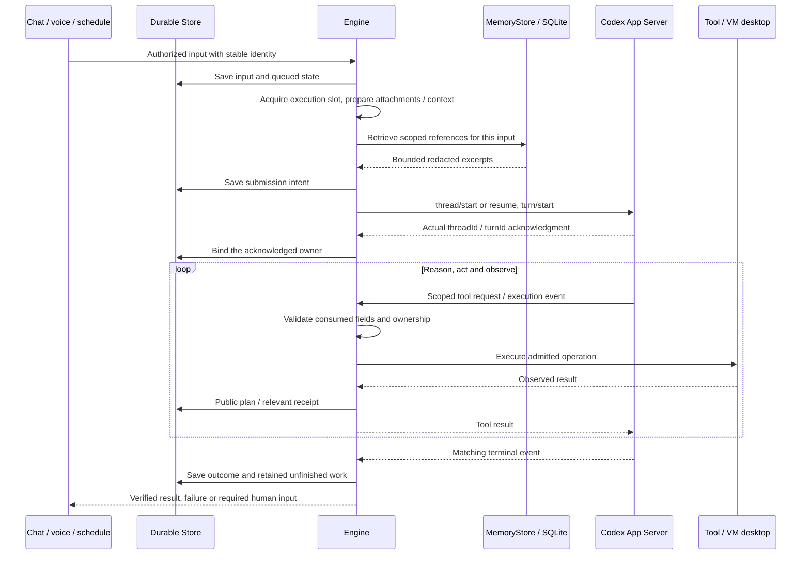
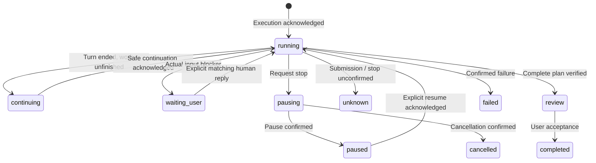
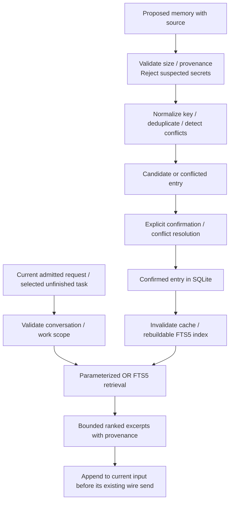

# System architecture

English · [Chinese](zh-CN/architecture.md)

dant is a local-first desktop agent. Tauri 2 provides the Windows host, a Controller manages the work computer, and an Ubuntu Worker owns execution and conversation data. This document describes the current source, including scoped memory retrieval, SQLite scheduling and protected local backups; published installers may contain an earlier implementation.

dant uses **Go Core + Rust Tauri + TypeScript UI**. Separate Go Controller and Worker roles own the complete backend. TypeScript implements the browser and build tools. Shared schemas, protocol defaults and locale data live in `resources/`. See [runtime support](runtime-support.md) and [Go Core](go-core.md).

## Overall system

The UI renders state and submits actions. The Controller **never constructs an Engine or executes agent work on Windows**. The Worker requires an ordinary user in a Linux VM with a healthy graphical desktop. Disconnecting the UI does not turn the Controller into an executor.

Public state collections use JSON arrays even when empty. Worker snapshots and older Controller cache projections expose absent schedules as `[]`; this display adaptation does not rewrite persisted state or advance its revision. Unknown collection types still fail validation.

Message Pin and Star actions update validated flags on the original saved message through a conversation-bound metadata route. They preserve active execution references and do not mark messages read, steer the model or authorize work. The chat menu provides search, starred messages and media/documents/HTTP links; navigation reveals the exact original message through the history window. Pinned summaries appear only when a message is pinned.

Chat initially renders the latest 80 messages and prepends older batches on demand. Reading history pins its first visible boundary while new messages arrive; conversation or VM changes reset the window. Reply, search and task-result navigation reveal their exact retained message before focusing it. Only rendered messages can become read. This limits DOM and Markdown work; the current state transport still transfers the complete conversation. Unchanged state skips a render, sanitized Markdown has a bounded cache, and timestamps follow the current system time zone. Background GET requests run independently while mutations retain their ordering and stale-result fences.

| Component             | Source                                                                                              | Responsibility                                                                             |
| --------------------- | --------------------------------------------------------------------------------------------------- | ------------------------------------------------------------------------------------------ |
| Native host           | `src-tauri/src/`                                                                                    | Window/tray, native IPC, notifications, secure host integration, installer handoff         |
| Application assembly  | [`core/internal/app/`](../core/internal/app/)                                                       | Worker APIs and service ownership, with host assembly in `core/internal/controller/`       |
| Runtime transport     | [`core/internal/runtime/`](../core/internal/runtime/)                                               | Codex process, JSON-RPC, validated events and response ownership                           |
| Agent execution       | [`Engine`](../core/internal/work/engine.go)                                                         | Admit input, bind acknowledged turns, handle tools, finalize results                       |
| Task continuity       | [`core/internal/work/`](../core/internal/work/)                                                     | Plans, replies, pause/cancel, retained projects and safe continuation                      |
| Heartbeat             | [`Supervisor`](../core/internal/work/supervisor.go)                                                 | Check whether an ended unfinished task can continue                                        |
| Scheduling            | [`Scheduler`](../core/internal/schedules/scheduler.go)                                              | Due times, recurrence, priority and dispatch receipts                                      |
| Memory / conversation | [`core/internal/memory/`](../core/internal/memory/)                                                 | SQLite memory, recall and migration, with conversation authority in `core/internal/store/` |
| Computer control      | [`core/internal/computer/`](../core/internal/computer/), `vm/`                                      | VM deployment, SSH, screenshots, input and control ownership                               |
| Host / VM adapters    | [`core/internal/platform/`](../core/internal/platform/), [`providers/`](../core/internal/computer/) | Host capabilities and provider-specific detection/setup/lifecycle commands                 |
| Local backups         | [`core/internal/backups/`](../core/internal/backups/)                                               | Protected Controller archives, Worker snapshots and explicit offline recovery              |

Production backend packages live under `core/internal/`, assembled by the small `core/cmd/dant-core` entrypoint through `application`. Controller and Worker are distinct roles of the compiled binary. The browser uses Vite, TypeScript and DOM/CSS. `resources/contracts/`, `resources/config/` and `resources/i18n/` own language-independent inputs; generated Go contracts and UI contracts are checked against those inputs. Every Go test lives under the mirrored `tests/go/` tree. Feature ownership and tests follow [code style](code-style.md).

## Agent loop and execution ownership

**Codex App Server owns model reasoning, tool iterations and the model conversation.** dant's Engine owns admission, persistence, identity, acknowledgments and delivery. There is no second application loop that calls an LLM at a fixed interval.

The Go Engine selects queued work, restores the matching conversation's Codex thread, routes scoped events/tools and records outcomes and deliverables. Bounded early events cannot establish ownership before a valid `turn/start` acknowledgment. Submission and work states are separate domains in the shared [state schema](../resources/contracts/state-domains.json), generated into Go and [`states.mts`](../ui/shared/states.mts).

Go concurrency serves transport and orchestration while preserving one execution owner. The Engine owns its cancellable lifetime, wake channel, bounded input queue, tool slots and joined workers. Memory and scheduling keep transaction ownership in their feature repositories; SQL and row mapping do not enter the UI or process entrypoint. Network cancellation retains request, connection, work and turn identity, and cannot convert an unknown side effect into a retry. Production binaries are compiled with CGO disabled; measured latency and device acceptance require their own evidence.

A durable `workId` survives turns. `task_plan` records actual steps; `task_list` and `task_cancel` use saved identities. Task replies carry `workId`, expected turn and conversation through ordinary chat. Live replies steer only their matching owner; ended work reopens through the same admission path with retained project context.

Work progress opens between chat and Computer as an independently scrollable panel. Header buttons follow that same order; responsive layout keeps panels in the document flow. Removing or cancelling a task confirms inside its own card, without moving focus to the top of the task list.

Work progress hides confirmed completed entries three days after their actual acceptance timestamp. A turn ending, an old request date or a completed checklist cannot supply that timestamp; legacy entries without a valid acceptance time remain visible. Review, waiting, paused, failed and uncertain work stays available. This changes presentation only: chat, task identity, project memory and reopening references remain stored. The existing presence ticker refreshes a visible progress panel when its next entry expires.

This summarizes durable work, rather than every chat transport state. A response ending, reading a message, a complete plan and user acceptance are different events. Restart pauses interrupted or unconfirmed execution. Unknown external outcomes require reconciliation before another submission; a timeout does not prove an action never happened.

## Heartbeat and scheduler

**Heartbeat continues existing authorized work; it is not a request for periodic progress messages.** If a task is already running, its current execution keeps going. The supervisor neither starts another run nor adds a heartbeat message.

| Mechanism                  | Timing                                                      | Behavior                                                    |
| -------------------------- | ----------------------------------------------------------- | ----------------------------------------------------------- |
| Unfinished-work supervisor | 30 seconds; about 5 seconds after a coalesced Engine change | Inspect eligibility; admit at most one continuation         |
| Schedule clock             | 1 second                                                    | Inspect due one-time/cron jobs and enqueue eligible work    |
| Active execution           | Codex events                                                | Continue reasoning/tool use without waiting for a heartbeat |

Idle checks do not call the LLM. Paused, cancelled, waiting-for-user, review and uncertain tasks cannot automatically continue. Offline state, an occupied executor and human control also block admission. Priority, due time and stable saved order choose eligible work; priority does not preempt active execution.

Continuation saves its claim before asynchronous submission and rechecks the exact task/turn. Ordinary automatic narration and deliveries are buffered; only completion, failure or a real input blocker publishes a consolidated outcome. Three unchanged rounds pause a task. Qualifying fresh execution evidence permits bounded extensions; repeated observations and failed actions do not count as progress. This extension cap is not a general model tool-step or token budget.

Schedules support one-time instants and five-field cron expressions in a saved IANA time zone. A missed recurring job catches up at most once, then advances to a future time; it cannot overlap its own unfinished work. [`ScheduleDatabase`](../core/internal/schedules/database.go) owns jobs, creation-request tombstones and dispatch receipts in `~/dant/data/schedules/schedules.sqlite`. Existing JSON schedules are backed up and imported once; later stale JSON cannot restore deleted or edited jobs. Revision compare-and-swap protects edits, and a unique schedule/occurrence key permits one durable claim across instances.

| Dispatch phase | Meaning                                                                                                    |
| -------------- | ---------------------------------------------------------------------------------------------------------- |
| `prepared`     | SQLite claim and immutable message identity saved; the JSON message may be absent.                         |
| `materialized` | The exact message is durable in JSON; execution has not been handed off.                                   |
| `held`         | Recovery permits persistence of that same message only, without enqueueing it.                             |
| `handed-off`   | The no-replay fence was committed before enqueue; a lost acknowledgment cannot authorize another dispatch. |

Chat messages remain in `state.json`. A short SQLite writer transaction serializes the exact-ID JSON message patch and phase change; this is not one atomic database transaction over both files. Restart recovers unhanded claims as the same paused message, preserving existing uncertain/submitting observations. The durable handoff fence prevents automatic replay even if enqueue throws or the JSON message is missing; it does not prove execution succeeded. Other full conversation writes retain the single-Worker ownership rule.

There is no separate 15-minute AI heartbeat that creates goals. Future proactive event sources must use explicit eligibility, deduplication and the same execution admission path.

## Memory: storage, cache and recall

SQLite manages durable memory, not Codex's original conversation or every application record. The Go Memory package uses pinned pure-Go `modernc.org/sqlite` through `database/sql`, with no independent database service or CGO runtime.

| Memory category | Current implementation                                                   | Durable authority                                 |
| --------------- | ------------------------------------------------------------------------ | ------------------------------------------------- |
| Working         | Active Engine state, task checkpoints, reused Codex thread               | `state.json` and Codex thread, with process state |
| Episodic        | Project context keyed by conversation/work ID; explicit episodic entries | `memory.sqlite`                                   |
| Semantic        | Identity/working reference notes; confirmed facts/preferences            | `memory.sqlite`                                   |
| Procedural      | Managed `SKILL.md` and required supporting files                         | Existing Skills storage / Markdown                |

The historical `working-memory.md` name remains a compatibility label for durable reference notes, not all live Working Memory. Shared assistant personality comes from [`identity.go`](../core/internal/memory/identity.go), separately from user reference data. Memory cannot authorize tool calls or start work.

### Durable storage and cache

`~/dant/data/memory/dant/memory.sqlite` holds `notes`, `projects`, `memory_entries`, revision metadata and the FTS5 index. The Go `memory.Store` is the sole production facade; [`Store`](../core/internal/memory/store.go) owns transactions; [`Markdown interchange`](../core/internal/memory/store_notes.go) owns explicit Markdown interchange.

Every read checks a durable revision inside the same SQLite read transaction before reusing cached notes, confirmed entries or project context. Table triggers advance the revision, including changes from other connections. Local writes invalidate the cache. Returned records are copies, project caching is bounded, and short-lived connections release handles after each transaction. The cache never becomes another source of truth.

The database has schema versioning, foreign-key enforcement, a bounded busy timeout, `synchronous=FULL` and a **DELETE journal**. DELETE journaling is part of the on-disk and backup contract. Enabling WAL would require a separate concurrency and recovery change; see [SQLite WAL](https://www.sqlite.org/wal.html).

Migration validates and backs up legacy Markdown/project JSON before import. Project IDs and available source timestamps survive; missing timestamps are not invented. SQLite then becomes authoritative. Editing a `.md` snapshot does not silently overwrite it: import/export is explicit. Task JSON may retain historical project snapshots, but task replies read current context through the bound SQLite adapter. Failed migration preserves its source and stops the failed operation.

The Memory settings page manages authoritative SQLite documents and structured facts/experiences through authenticated `/api/memory/manage` routes. Logical document IDs are labeled as documents, not presented as filesystem provenance. Keyword search scopes project and entry results before the FTS limit; shared documents remain global. Lists are paged, source/task identities are retained, and shared assistant personality is displayed separately as read-only text. Edits, clears, deletion and explicit candidate confirmation compare the captured database revision inside the write transaction. Editing a structured fact returns it to candidate review; conflicting confirmed facts are never silently replaced. Redacted records cannot be edited over their hidden original. A lost or unconfirmed mutation is not retried: the UI requires a fresh authoritative read before another action. Legacy read-only `/api/memory/view` remains available.

### Consolidation and retrieval

`Store.Propose`, `Store.Confirm`, `Store.Update` and `Store.Delete` implement the storage workflow. Entries retain source kind, available conversation/task/message references, supplied confidence and actual creation/update times. Candidates and conflicts stay out of effective context/search; conflicts require explicit resolution, and editing a confirmed entry requires confirmation again. Suspected credentials are rejected, and reference text is sanitized/redacted before model use. These controls do not make arbitrary sensitive material suitable for retention.

`search(query)` remains an explicit bounded keyword API. Automatic [`retrieve(query, scope)`](../core/internal/memory/store_search.go) normalizes a bounded current query, removes common filler terms and combines literal terms with **OR** in parameterized FTS5. Scope filtering precedes ranking and limits: shared notes and unscoped confirmed semantic facts are eligible; scoped facts require the matching conversation/work, and project context requires the selected work ID. Candidates, conflicts and other projects stay out. Chinese keyword matching is supported; there are no embeddings or vector searches.

Agent base memory context contains the safe identity/working notes only. The at-most-32-confirmed-entry `context()` view remains for compatibility/read-only use, rather than blanket injection into every agent prompt. [`Store.AgentContext`](../core/internal/memory/store_search.go) adds up to six bounded, redacted references with provenance to the **current already-admitted input**. Normal turns, steering, automatic continuation, recognized audio and native/API typed call input read fresh memory immediately before their existing wire send; API voice task handoffs use the same Engine input path. No match leaves the original input unchanged. Revision checks make edits, deletion and conflict changes visible without retaining a recalled-result cache.

Recall neither mutates the human message nor adds a separate inference request, execution turn or persistent reference-injection operation. It cannot authorize actions or resume other work. Old Codex history is not erased; the reference marks its current-input scope and supersedes earlier excerpts for that input. Idle heartbeat checks do not retrieve memory. Memory & personality exposes the validated document and entry management described above; automatic extraction/consolidation is not implemented. The compatible `memory_write` tool still edits reference notes directly.

Codex owns the model thread, context window, compaction and provider token accounting. dant does not convert all chat into semantic memories or rebuild the thread from shortened UI history. See [context](context.md).

## Tools, authentication and computer ownership

Tool schemas and handlers support desktop operations, plans, schedules, credentials and Skills, including `dant_desktop` MCP. Web pages, files and memory are reference data rather than permissions. Go and browser boundary decoders validate consumed fields from unknown disk/transport data; static types do not replace runtime validation.

The Controller and Worker each default to their own `127.0.0.1:4317`; the guest desktop service defaults to `127.0.0.1:4321`. Shared configuration validates deployment options. Development `.env` is optional, and installers have defaults. See [configuration](configuration.md).

API authentication uses `X-Dant-Token`, host/origin checks and a fixed native endpoint descriptor. **Tokens authenticate; they do not encrypt HTTP.** Controller/Worker traffic travels through SSH local forwarding; model/Telegram connections use their respective encrypted transports. The API is not exposed on the guest network adapter. Tokens and secrets stay out of public snapshots, logs and memory; VM vault and Windows DPAPI serve their separate credential roles.

Current Codex sessions use `approvalPolicy: 'never'` and `danger-full-access` inside the VM. Actual boundaries include the VM, ordinary-user account, bounded file routes, authentication and desktop lease. **There is no independent general Policy Engine providing per-command/per-delete approval for all model shell actions.** Tauri capabilities constrain the native bridge, not all Worker execution paths. Stronger tool policies and approvals need a separate implementation.

Human takeover reserves ownership, interrupts the exact turn and waits for a confirmed stop before granting a guest control lease. Python tools and UI input share the lock/lease. Expired or mismatched sessions cannot inject input; returning control does not replay paused work. These controls cannot guarantee termination of previously detached processes or replace OS permissions.

## Persistence and lifecycle

| Owner              | Data                                                                    | Recovery rule                                                              |
| ------------------ | ----------------------------------------------------------------------- | -------------------------------------------------------------------------- |
| Windows Controller | Connection/deployment receipts, preferences, offline `state-cache.json` | Display cache never enables host execution                                 |
| Controller backups | `backup-settings.json`, `vm-backups/*.dantbak`                          | Per-source encrypted copies; explicit preview and verified restore receipt |
| Worker Store       | `state.json`: messages, work, read/delivery/submission receipts         | Preserve identities; pause interrupted/uncertain execution                 |
| Worker schedules   | `schedules/schedules.sqlite`, legacy import backup                      | CAS edits, unique occurrence claims and durable no-replay fences           |
| Worker memory      | `memory/dant/memory.sqlite`, explicit exports, migration backups        | Transactions + revision-aware cache; old files are not live authority      |
| Worker files       | Immutable UUID attachments; conversation workspace/output               | Bounded archival, independent delivered copies                             |
| Codex runtime      | Persistent thread and private conversation                              | Resume only for the matching conversation/runtime                          |
| Credentials        | Restricted VM vault; relevant Windows DPAPI secrets                     | No raw secrets in ordinary state exports                                   |

Closing the main window hides dant to the tray when tray initialization succeeded; unavailable tray integration falls back to normal window close. Explicit Exit pauses work, confirms stopping and suspends the owned VM; reopening restores it without silently resuming paused tasks. Service updates keep the VM running while paused work allows replacement/version verification. Installer handoff adds an admission lease and owned-process/VM checks. Background work can continue with the window closed, **not while the VM is suspended after Exit or the host is asleep**. See [VM](VM.md) and [updates](updates.md).

Calls separate media and task identities: normal hangup can leave accepted work running; uncertain shutdown does not prove work stopped. The floating call window forwards scoped controls without another microphone/executor. Telegram shares the Store and Engine, with stable input IDs, pairing and durable outbound receipts. Neither creates another runtime. See [voice](VOICE-KEY.md), [shared context](context.md) and [Telegram](TELEGRAM.md).

Live captions display only the current call's received, redacted **assistant** speech text; they do not promise a complete two-sided transcript. The Worker and Controller retain a bounded `callCaption` snapshot in RAM so native desktop state polling can receive the existing subtitle stream. Call/provider/sequence and conversation/connection checks reject stale text; ending or disconnecting clears it. The last received segment remains readable until the next response clears or replaces it. Captions never enter chat, Store, Controller disk cache, diagnostics or backups. The saved `showCallCaptions` preference defaults to on and can be changed in Voice settings or with the call's caption button, without changing media or starting work. An expanded call covers only the conversation pane; Work progress and Computer remain independently visible.

## Local backups and recovery

[`backups.Manager`](../core/internal/backups/manager.go) owns local backup settings, periodic/connection triggers and explicit restore consent. It obtains idle agent-data snapshots through the authenticated Worker transport: memory, chat/task history and settings, schedules, saved attachments, local integration state and managed skills. Browser profiles, virtual environments and unrelated workspace projects are excluded. It retains encrypted `.dantbak` archives under the Controller data directory. AES-256-GCM keys are protected through the HostPlatform secret provider; Windows implements DPAPI, while a host without a provider refuses plaintext storage. Copies are retained per source binding, defaulting to ten per work computer.

Worker export runs cancellable file copying, SQLite snapshots, hashing and archive streaming in Go, independently of state handlers. Bounded buffers and the HTTP writer apply backpressure. Only one export may stage or stream at a time. The API checks idle execution before capture and rechecks captured execution ownership before success. New work invalidates an unfinished capture. Disconnect, timeout and service shutdown cancel owned work, close handles and remove only the identity-checked private staging container.

Atomic publication retains the file identity captured from its opened handle, then verifies the written size and snapshot again after closing. Backup retention also verifies its selected file before deletion. An identity mismatch stops publication or cleanup; recapturing a path cannot authorize publishing or deleting its new contents. Windows file IDs and user/system directories come from the current operating system and opened files, independently of drive letters and account names.

After a restore commits, cleanup of the previous data and workspace directories checks the identities recorded for that restore attempt. Incoming and rollback staging names must already be absent; unexpected entries there are preserved. A replacement keeps the journal pending even when the separate receipt confirms the restored data. Another archive cannot be read until that cleanup has been reconciled.

Memory backup validation uses a read-only SQLite connection and checks both database integrity and the canonical tables' stored types, allowed values and byte limits. An integrity-check result alone does not establish those application constraints. Validation never repairs the source database. Markdown and JSON recovery snapshots share complete-write, sync and close checks, and an unconfirmed snapshot cannot mark an import complete.

Portable `.dant` files are a separate, versioned transfer format. [`backups.Portable`](../core/internal/backups/portable.go) derives a key from a user-supplied passphrase with fixed scrypt parameters and protects the archive and metadata with AES-256-GCM. A pure streaming validator checks paths, frames, file hashes and counts while removing known authentication stores. Import authenticates and validates the complete encrypted staging file before re-encrypting it into the destination's local vault. No plaintext archive is staged. The original local backup remains unchanged.

The first-run UI asks about a backup before offering VM creation. Import is local and works without a connected VM; restoration remains a separate target-bound preview and confirmation. Tauri owns file pickers and bounded streaming file transfer through the authenticated loopback Controller API. The browser uses the same format with a smaller transfer limit. This permits copying a companion between supported frontends, computers and VMs. It does not coordinate two live copies. A future Google Drive adapter can store the same portable format; no Drive integration is implemented here.

Restored data belongs to the destination roots, including a different Linux home directory. The Engine consumes a narrow attachment reader bound to the current AttachmentStore: immutable IDs select bounded, hash-verified bytes and current paths before input preparation. Historical message paths cannot override that store or authorize a fallback. The stored message, identities and user text remain unchanged. Skills derive their current workspace paths, SQLite stores open under the new data root, and unknown execution metadata remains fenced until reconciled.

The Worker captures data SQLite databases with `VACUUM INTO` and integrity checks. New schema version 2 archives declare the `agent-data` scope and contain only owned data paths and managed skill roots. Capture and capacity estimation share selection rules; excluded project, browser and environment trees are not recursively scanned. Every included source is checked again before success. Skill binary assets retain their bytes; links and special files in included roots are rejected. Each database snapshot is consistent, but the complete multi-file archive is not a whole-system transaction. Version 1 archives retain their original contents and semantics.

Restoration requires a bounded metadata/warning preview and a single-use confirmation tied to the current target. The Controller pauses work, stops the Worker and uses guarded SSH to run the offline restore CLI. Private staging and an ownership journal support rollback/recovery. Scoped restores replace data plus only included managed skill libraries, preserving unrelated workspace paths and existing parent identities; absent libraries are retained. Legacy archives still replace both roots. These are component transactions rather than one cross-filesystem atomic rename. Tasks and schedules stay paused/disabled, uncertain submissions retain their fences, Telegram is disabled and model sign-in may be required. Completion requires the exact startup-loaded receipt. Unknown outcomes are reconciled, never resent. See [backup configuration and recovery](backups.md).

An exact durable rejection proof can distinguish a validated non-application or completed rollback from an unknown outcome. The proof is outside both restored roots and checked under the kernel lock against the restore ID and both live root identities. Only that proof can release the matching Controller intent as failed; it cannot mark the restore successful or replay it. Interrupted replacement without a proof remains unknown.

## Host platform and VM provider capabilities

[`platform.Host`](../core/internal/platform/host.go) and [`platform.New`](../core/internal/platform/host.go) now provide an implemented host capability boundary: platform identity, managed-VM/existing-SSH support, fixed command/configuration access and optional protected-secret storage. This abstraction does not move native window/notification ownership out of Tauri or create another task executor.

[`computer.Providers`](../core/internal/computer/providers.go) contains Hyper-V and VMware adapters plus an unmanaged SSH capability. [`computer.NewProviders`](../core/internal/computer/providers.go) supplies detection, setup plans and fixed lifecycle commands. Provisioning and `VmLifecycle` consume these adapters; VM ownership, quiescence and result confirmation remain with their existing lifecycle services. SSH alone supplies no verified hypervisor suspend/resume capability. Missing capabilities return an explicit unavailable result, with no provider or host-shell execution fallback.

The current managed adapters still require Windows. Platform IDs and an SSH capability for recognized Unix hosts are extension points, not proof of supported macOS/Linux desktop releases. Future hosts need their own tested lifecycle, protected-secret, native integration and release adapters. They retain the same Controller/Worker split, Engine, memory and scheduler; the Ubuntu Worker remains the execution authority.

## Runtime updates

The Controller validates the packaged Linux binary and fixed helper inventory against version, source commit, lengths and SHA-256 before deployment. `vm/worker-install.py` serializes installation with a kernel lock and checks backup and migration capacity on each affected filesystem before stopping the existing Worker. It blocks new admission through the current maintenance protocol, or verifies a supported earlier maintenance route before stopping its service. It verifies that the prior service and owned Codex processes stopped, creates and validates a private recovery archive, then prepares existing data offline with the Go binary. An unknown stop, insufficient space, incompatible database or missing backup blocks activation. Deployment has its own bounded timeout; ordinary VM requests keep their shorter limits.

The Worker service starts only the verified Go executable. Readiness must match the target version and source before the Controller marks the update current. Failure preserves data and the recovery archive. The data-root ownership lock excludes another writer; independent stopped-process proof is also required before replacement. See [Go Core](go-core.md) for the full ownership boundary.

An interrupted attempt remains an execution fence. Automatic updates never replay it. The explicit `reconcile-stopped` operation accepts only a verified attempt that stopped before preparation, requires its exact identity and journal hash plus independent stopped-process proof, and preserves the old evidence before reserving a new attempt. A newer verified operator may supply read-only capacity preflight for an older target; export, preparation and running-version proof still belong to the exact target bundle. Native exit failures report bounded reason codes and phases while retaining the original pause and VM-suspension requirements.

## Current limits and next steps

The following decisions guide further work. They preserve the existing execution architecture rather than introducing another agent runtime.

| Area                       | Decision                               | Next action                                                                               |
| -------------------------- | -------------------------------------- | ----------------------------------------------------------------------------------------- |
| Controller / Worker        | Retain the boundary                    | Keep execution and durable conversation authority in the Worker                           |
| Codex App Server           | Retain the model/tool loop             | Extend orchestration without implementing a competing reasoning loop                      |
| Single execution admission | Retain one execution owner             | Route every new input source through the existing admission and acknowledgment checks     |
| Heartbeat                  | Retain current continuation design     | Continue actionable unfinished work without periodic chat narration                       |
| Scheduler                  | SQLite authority and dispatch outbox   | Preserve CAS, recovery fences, recurrence and no-overlap behavior                         |
| MemoryStore                | Scoped automatic retrieval implemented | Retain fresh current-input references and explicit confirmation of structured facts       |
| SQLite + FTS5              | Retain keyword search                  | No independent vector database at this stage                                              |
| VM portability             | Capability adapters implemented        | Extend and verify host-specific lifecycle, secret-protection and desktop release adapters |
| Tool security              | Add independent permission enforcement | Cover all execution paths, including Codex built-in tools and MCP                         |

Recall and schedule recovery tests cover cross-project isolation, no-match/deleted/conflicting memories, fresh pre-send reads, unchanged user content, competing claims and cross-file crash windows. Future input sources must retain these boundaries and use the existing admission path.

The permission service should validate the actual tool, arguments, task/turn owner and authorized resources **before execution**, then allow, deny or persist an approval request. Approval must bind to that exact operation; changing the arguments or owner invalidates it. Enforcement must account for Codex's built-in shell/file actions as well as application tools; adding checks only to dynamic tools would leave a bypass. This requires changes to the current execution/approval configuration, plus tests for denied actions and uncertain approval results. It must not add a second Agent loop or treat model text, memory or a web page as permission.

The architecture reference informs boundaries; it does not mean its proposed features already exist:

- SQLite owns memory and schedules in separate databases; messages, durable task state, events and approvals have not moved into a unified SQL schema.
- Continuation guards, stop controls, timeouts and bounded evidence extensions exist; unified per-task tool-step, elapsed-time and token budgets remain to be designed.
- Scoped automatic retrieval, candidate storage and validated memory editing exist; embeddings and automatic consolidation remain future work.
- Windows Controller / Ubuntu Worker lifecycle exists; a cross-platform independent user service with named pipes/Unix sockets is not implemented.
- Generated Go/TypeScript state contracts and runtime validators exist; React, Zustand, Tailwind, Zod and a pnpm monorepo are not current dependencies.

Feature tests use isolated stores, injected clocks/transports and fixture executors. They verify ownership, persistence, uncertainty and recovery without operating a user's VM or account. Passing them does not establish live audio quality, notification delivery or desktop task success. Commands and acceptance records belong in [CI](ci.md) and [verification](verification.md).
