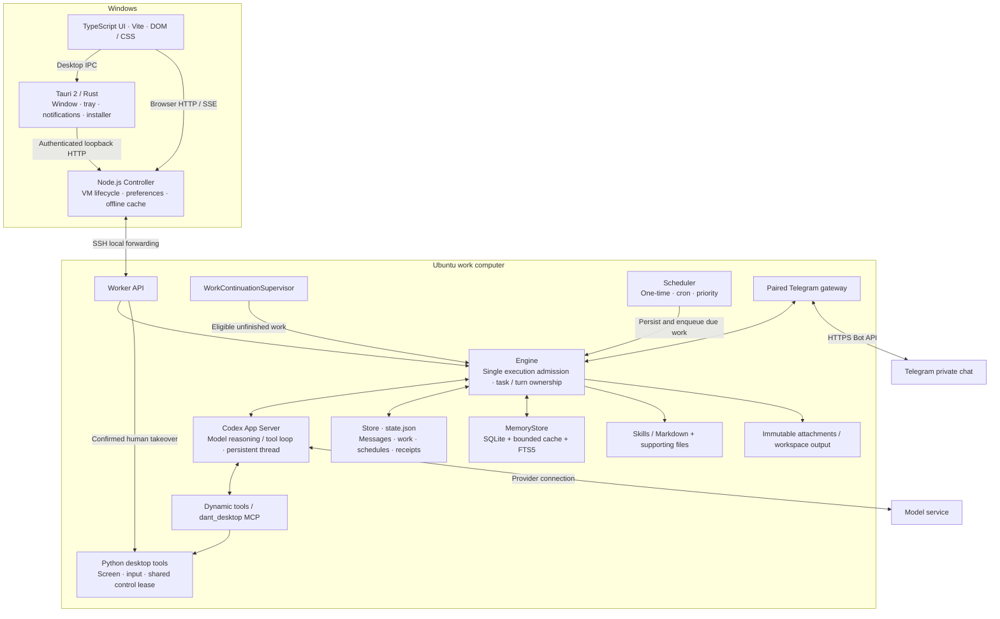
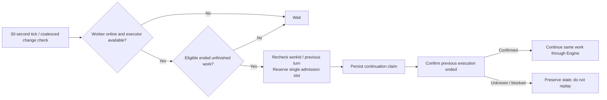
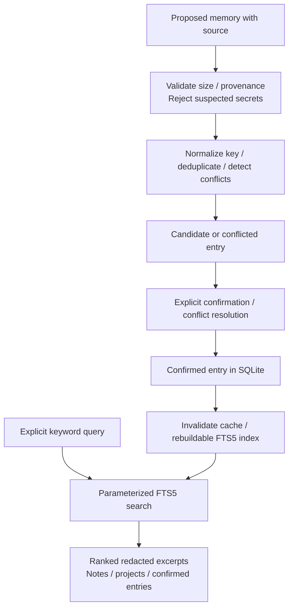

# System architecture

English · [Chinese](zh-CN/architecture.md)

dant is a local-first desktop agent. Tauri 2 provides the Windows host, a Controller manages the work computer, and an Ubuntu Worker owns execution and conversation data. This document describes the current source, including the SQLite memory migration; published installers may contain an earlier implementation.

## Overall system



The UI renders state and submits actions. The Controller **never constructs an Engine or executes agent work on Windows**. The Worker requires an ordinary user in a Linux VM with a healthy graphical desktop. Disconnecting the UI does not turn the Controller into an executor.

| Component             | Source                                                       | Responsibility                                                                     |
| --------------------- | ------------------------------------------------------------ | ---------------------------------------------------------------------------------- |
| Native host           | `src-tauri/src/`                                             | Window/tray, native IPC, notifications, secure host integration, installer handoff |
| Application assembly  | [`src/app/`](../src/app/)                                    | Controller/Worker modes, APIs and service ownership                                |
| Runtime transport     | [`src/runtime/`](../src/runtime/)                            | Codex process, JSON-RPC, validated events and response ownership                   |
| Agent execution       | [`engine.mts`](../src/work/engine.mts)                       | Admit input, bind acknowledged turns, handle tools, finalize results               |
| Task continuity       | [`src/work/`](../src/work/)                                  | Plans, replies, pause/cancel, retained projects and safe continuation              |
| Heartbeat             | [`work-continuation.mts`](../src/work/work-continuation.mts) | Check whether an ended unfinished task can continue                                |
| Scheduling            | [`scheduler.mts`](../src/schedules/scheduler.mts)            | Due times, recurrence, priority and dispatch receipts                              |
| Memory / conversation | [`src/conversation/`](../src/conversation/)                  | Store, shared reference context, SQLite memory and migration                       |
| Computer control      | [`src/computer/`](../src/computer/), `vm/`                   | VM deployment, SSH, screenshots, input and control ownership                       |

Runtime modules use native erasable TypeScript (`.mts`); shared types use `.ts`. The browser uses Vite, TypeScript and DOM/CSS. Feature folders and matching tests follow [code style](code-style.md). This is currently an npm repository, not a React application or pnpm workspace monorepo.

## Agent loop and execution ownership

**Codex App Server owns model reasoning, tool iterations and the model conversation.** dant's Engine owns admission, persistence, identity, acknowledgments and delivery. There is no second application loop that calls an LLM at a fixed interval.

```mermaid
sequenceDiagram
  participant Input as Chat / voice / schedule
  participant Store as Durable Store
  participant Engine
  participant Codex as Codex App Server
  participant Tool as Tool / VM desktop
  Input->>Engine: Authorized input with stable identity
  Engine->>Store: Save input and queued state
  Engine->>Engine: Acquire execution slot; prepare attachments / context
  Engine->>Store: Save submission intent
  Engine->>Codex: thread/start or resume; turn/start
  Codex-->>Engine: Actual threadId / turnId acknowledgment
  Engine->>Store: Bind the acknowledged owner
  loop Reason, act and observe
    Codex->>Engine: Scoped tool request / execution event
    Engine->>Engine: Validate consumed fields and ownership
    Engine->>Tool: Execute admitted operation
    Tool-->>Engine: Observed result
    Engine->>Store: Public plan / relevant receipt
    Engine-->>Codex: Tool result
  end
  Codex-->>Engine: Matching terminal event
  Engine->>Store: Save outcome and retained unfinished work
  Engine-->>Input: Verified result, failure or required human input
```

`Engine.pump()` selects queued work, thread setup restores the matching conversation's Codex thread, `handle()` routes scoped events/tools, and `complete()` records the outcome and deliverables. Bounded early events cannot establish ownership before a valid `turn/start` acknowledgment. Submission and work states are separate domains in [`states.mts`](../src/contracts/states.mts).

A durable `workId` survives turns. `task_plan` records actual steps; `task_list` and `task_cancel` use saved identities. Task replies carry `workId`, expected turn and conversation through ordinary chat. Live replies steer only their matching owner; ended work reopens through the same admission path with retained project context.

```mermaid
stateDiagram-v2
  [*] --> running: Execution acknowledged
  running --> continuing: Turn ended; work unfinished
  continuing --> running: Safe continuation acknowledged
  running --> waiting_user: Actual input blocker
  waiting_user --> running: Explicit matching human reply
  running --> pausing: Request stop
  pausing --> paused: Pause confirmed
  pausing --> cancelled: Cancellation confirmed
  running --> unknown: Submission / stop unconfirmed
  running --> review: Complete plan verified
  review --> completed: User acceptance
  paused --> running: Explicit resume acknowledged
  running --> failed: Confirmed failure
```



This summarizes durable work, rather than every chat transport state. A response ending, reading a message, a complete plan and user acceptance are different events. Restart pauses interrupted or unconfirmed execution. Unknown external outcomes require reconciliation before another submission; a timeout does not prove an action never happened.

## Heartbeat and scheduler

**Heartbeat continues existing authorized work; it is not a request for periodic progress messages.** If a task is already running, its current execution keeps going. The supervisor neither starts another run nor adds a heartbeat message.



| Mechanism                  | Timing                                                      | Behavior                                                    |
| -------------------------- | ----------------------------------------------------------- | ----------------------------------------------------------- |
| Unfinished-work supervisor | 30 seconds; about 5 seconds after a coalesced Engine change | Inspect eligibility; admit at most one continuation         |
| Schedule clock             | 1 second                                                    | Inspect due one-time/cron jobs and enqueue eligible work    |
| Active execution           | Codex events                                                | Continue reasoning/tool use without waiting for a heartbeat |

Idle checks do not call the LLM. Paused, cancelled, waiting-for-user, review and uncertain tasks cannot automatically continue. Offline state, an occupied executor and human control also block admission. Priority, due time and stable saved order choose eligible work; priority does not preempt active execution.

Continuation saves its claim before asynchronous submission and rechecks the exact task/turn. Ordinary automatic narration and deliveries are buffered; only completion, failure or a real input blocker publishes a consolidated outcome. Three unchanged rounds pause a task. Qualifying fresh execution evidence permits bounded extensions; repeated observations and failed actions do not count as progress. This extension cap is not a general model tool-step or token budget.

Schedules support one-time instants and five-field cron expressions in a saved IANA time zone. A missed recurring job catches up at most once, then advances to a future time. It cannot overlap its own unfinished work. Dispatch persists the claim and queued message together before execution; stable creation request IDs and deletion tombstones protect uncertain acknowledgments. Scheduling currently persists in `state.json`, rather than SQLite lease tables.

There is no separate 15-minute AI heartbeat that creates goals. Future proactive event sources must use explicit eligibility, deduplication and the same execution admission path.

## Memory: storage, cache and recall

SQLite manages durable memory, not Codex's original conversation or every application record. This implementation uses built-in `node:sqlite`, without an independent database service.

| Memory category | Current implementation                                                   | Durable authority                                 |
| --------------- | ------------------------------------------------------------------------ | ------------------------------------------------- |
| Working         | Active Engine state, task checkpoints, reused Codex thread               | `state.json` and Codex thread, with process state |
| Episodic        | Project context keyed by conversation/work ID; explicit episodic entries | `memory.sqlite`                                   |
| Semantic        | Identity/working reference notes; confirmed facts/preferences            | `memory.sqlite`                                   |
| Procedural      | Managed `SKILL.md` and required supporting files                         | Existing Skills storage / Markdown                |

The historical `working-memory.md` name remains a compatibility label for durable reference notes, not all live Working Memory. Shared assistant personality comes from [`identity.mts`](../src/conversation/identity.mts), separately from user reference data. Memory cannot authorize tool calls or start work.

### Durable storage and cache

`~/dant/data/memory/dant/memory.sqlite` holds `notes`, `projects`, `memory_entries`, revision metadata and the FTS5 index. `MemoryStore` is the facade; [`memory-sqlite.mts`](../src/conversation/memory-sqlite.mts) owns transactions; [`memory-markdown.mts`](../src/conversation/memory-markdown.mts) owns explicit Markdown interchange.

Every read checks a durable revision inside the same SQLite read transaction before reusing cached notes, confirmed entries or project context. Table triggers advance the revision, including changes from other connections. Local writes invalidate the cache. Returned records are copies, project caching is bounded, and short-lived connections release handles after each transaction. The cache never becomes another source of truth.

The database has schema versioning, foreign-key enforcement, a bounded busy timeout, `synchronous=FULL` and a **DELETE journal**. WAL is deliberately not enabled for the declared older Node/SQLite baseline; changing it requires a supported SQLite version and concurrency verification. See [Node SQLite](https://nodejs.org/api/sqlite.html) and [SQLite WAL](https://www.sqlite.org/wal.html).

Migration validates and backs up legacy Markdown/project JSON before import. Project IDs and available source timestamps survive; missing timestamps are not invented. SQLite then becomes authoritative. Editing a `.md` snapshot does not silently overwrite it: import/export is explicit. Task JSON may retain historical project snapshots, but task replies read current context through the bound SQLite adapter. Failed migration preserves its source and stops the failed operation.

### Consolidation and retrieval



`proposeEntry`, `confirmEntry`, `updateEntry` and `deleteEntry` implement the storage workflow. Entries retain source kind, available conversation/task/message references, supplied confidence and actual creation/update times. Candidates and conflicts stay out of effective context/search; conflicts require explicit resolution, and editing a confirmed entry requires confirmation again. Suspected credentials are rejected, and reference text is sanitized/redacted before model use. These controls do not make arbitrary sensitive material suitable for retention.

`search(query)` provides bounded keyword recall over notes, project context and confirmed semantic/episodic entries. FTS uses parameter binding and literal terms; its index is rebuildable. Chinese keyword matching is supported. There are no embeddings or vector searches.

Current prompt construction includes safe identity/working notes and at most 32 latest confirmed entries; project replies also load the matching project context. **FTS is currently an explicit MemoryStore API, not automatic retrieval for each message or heartbeat.** Candidate CRUD is also programmatic; the existing Memory & personality page displays effective context read-only. A full editor, automatic candidate extraction and relevance/recency/confidence ranking remain integration work. The compatible `memory_write` tool still edits reference notes directly; it has not been converted into the structured candidate-confirmation workflow.

Codex owns the model thread, context window, compaction and provider token accounting. dant does not convert all chat into semantic memories or rebuild the thread from shortened UI history. See [context](context.md).

## Tools, authentication and computer ownership

Tool schemas and handlers support desktop operations, plans, schedules, credentials and Skills, including `dant_desktop` MCP. Web pages, files and memory are reference data rather than permissions. Runtime decoders validate consumed fields from unknown disk/transport data; TypeScript types alone cannot do this.

The Controller and Worker each default to their own `127.0.0.1:4317`; the guest desktop service defaults to `127.0.0.1:4320`. Shared configuration validates deployment options. Development `.env` is optional, and installers have defaults. See [configuration](configuration.md).

API authentication uses `X-Dant-Token`, host/origin checks and a fixed native endpoint descriptor. **Tokens authenticate; they do not encrypt HTTP.** Controller/Worker traffic travels through SSH local forwarding; model/Telegram connections use their respective encrypted transports. The API is not exposed on the guest network adapter. Tokens and secrets stay out of public snapshots, logs and memory; VM vault and Windows DPAPI serve their separate credential roles.

Current Codex sessions use `approvalPolicy: 'never'` and `danger-full-access` inside the VM. Actual boundaries include the VM, ordinary-user account, bounded file routes, authentication and desktop lease. **There is no independent general Policy Engine providing per-command/per-delete approval for all model shell actions.** Tauri capabilities constrain the native bridge, not the Node Worker. Stronger tool policies and approvals need a separate implementation.

Human takeover reserves ownership, interrupts the exact turn and waits for a confirmed stop before granting a guest control lease. Python tools and UI input share the lock/lease. Expired or mismatched sessions cannot inject input; returning control does not replay paused work. These controls cannot guarantee termination of previously detached processes or replace OS permissions.

## Persistence and lifecycle

| Owner              | Data                                                                       | Recovery rule                                                         |
| ------------------ | -------------------------------------------------------------------------- | --------------------------------------------------------------------- |
| Windows Controller | Connection/deployment receipts, preferences, offline `state-cache.json`    | Display cache never enables host execution                            |
| Worker Store       | `state.json`: messages, work, schedules, read/delivery/submission receipts | Preserve identities; pause interrupted/uncertain execution            |
| Worker memory      | `memory/dant/memory.sqlite`, explicit exports, migration backups           | Transactions + revision-aware cache; old files are not live authority |
| Worker files       | Immutable UUID attachments; conversation workspace/output                  | Bounded archival, independent delivered copies                        |
| Codex runtime      | Persistent thread and private conversation                                 | Resume only for the matching conversation/runtime                     |
| Credentials        | Restricted VM vault; relevant Windows DPAPI secrets                        | No raw secrets in ordinary state exports                              |

Closing the main window hides dant to the tray when tray initialization succeeded; unavailable tray integration falls back to normal window close. Explicit Exit pauses work, confirms stopping and suspends the owned VM; reopening restores it without silently resuming paused tasks. Service updates keep the VM running while paused work allows replacement/version verification. Installer handoff adds an admission lease and owned-process/VM checks. Background work can continue with the window closed, **not while the VM is suspended after Exit or the host is asleep**. See [VM](VM.md) and [updates](updates.md).

Calls separate media and task identities: normal hangup can leave accepted work running; uncertain shutdown does not prove work stopped. The floating call window forwards scoped controls without another microphone/executor. Telegram shares the Store and Engine, with stable input IDs, pairing and durable outbound receipts. Neither creates another runtime. See [voice](VOICE-KEY.md), [shared context](context.md) and [Telegram](TELEGRAM.md).

## Current limits and next steps

The following decisions guide further work. They preserve the existing execution architecture rather than introducing another agent runtime.

| Area                       | Decision                                | Next action                                                                              |
| -------------------------- | --------------------------------------- | ---------------------------------------------------------------------------------------- |
| Controller / Worker        | Retain the boundary                     | Keep execution and durable conversation authority in the Worker                          |
| Codex App Server           | Retain the model/tool loop              | Extend orchestration without implementing a competing reasoning loop                     |
| Single execution admission | Retain one execution owner              | Route every new input source through the existing admission and acknowledgment checks    |
| Heartbeat                  | Retain current continuation design      | Continue actionable unfinished work without periodic chat narration                      |
| Scheduler                  | Keep current persistence for now        | Preserve recurrence, catch-up and no-overlap behavior; no immediate SQL migration        |
| MemoryStore                | **First priority: automatic retrieval** | Connect bounded, scoped FTS recall to context construction                               |
| SQLite + FTS5              | Retain keyword search                   | No independent vector database at this stage                                             |
| VM portability             | Further abstract providers              | Separate provider lifecycle capabilities from Windows-specific Hyper-V / VMware adapters |
| Tool security              | Add independent permission enforcement  | Cover all execution paths, including Codex built-in tools and MCP                        |

Automatic retrieval should use the current human request or the selected task's actual context, query confirmed memories in the proper conversation/project scope, and inject bounded, redacted references with provenance. It must keep candidates out, preserve explicit identity/preferences, and invalidate results after edits or deletion. An idle heartbeat should perform neither recall nor inference merely because its timer fired. Relevant tests must cover cross-project isolation, no-match behavior, stale cache, deleted/conflicting facts and unchanged user content. This is the next integration milestone, not current behavior.

The permission service should validate the actual tool, arguments, task/turn owner and authorized resources **before execution**, then allow, deny or persist an approval request. Approval must bind to that exact operation; changing the arguments or owner invalidates it. Enforcement must account for Codex's built-in shell/file actions as well as application tools; adding checks only to dynamic tools would leave a bypass. This requires changes to the current execution/approval configuration, plus tests for denied actions and uncertain approval results. It must not add a second Agent loop or treat model text, memory or a web page as permission.

The architecture reference informs boundaries; it does not mean its proposed features already exist:

- SQLite currently covers memory, not a unified SQL schema for messages, task runs, events, approvals and schedules.
- Continuation guards, stop controls, timeouts and bounded evidence extensions exist; unified per-task tool-step, elapsed-time and token budgets remain to be designed.
- Keyword search and candidate storage exist; automatic retrieval, a memory editor, embeddings and automatic consolidation need integration and verification.
- Windows Controller / Ubuntu Worker lifecycle exists; a cross-platform independent user service with named pipes/Unix sockets is not implemented.
- TypeScript contracts and runtime validators exist; React, Zustand, Tailwind, Zod and a pnpm monorepo are not current dependencies.

Feature tests use isolated stores, injected clocks/transports and fixture executors. They verify ownership, persistence, uncertainty and recovery without operating a user's VM or account. Passing them does not establish live audio quality, notification delivery or desktop task success. Commands and acceptance records belong in [CI](ci.md) and [verification](verification.md).
