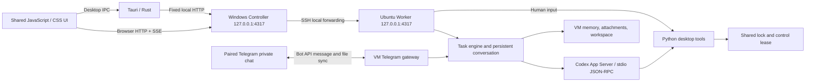
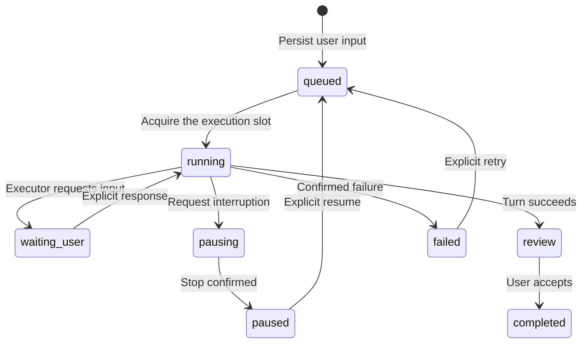
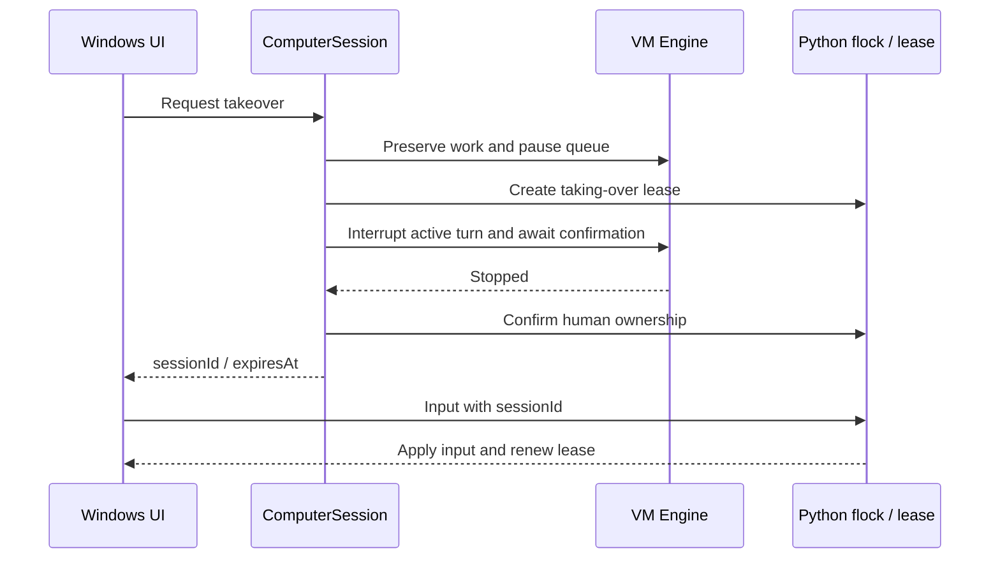

# dant Windows architecture

English · [Chinese](zh-CN/architecture.md)

This implementation follows the supplied Mac/UTM architecture and 15 reference screens. Windows substitutes Hyper-V, AMD64 Ubuntu, OpenSSH, and a native desktop host while preserving responsibility boundaries.

## Modes and data ownership

| Mode | Responsibility |
| --- | --- |
| `--prepare` | UI and setup preparation; no automatic VM connection or model execution. |
| Default / `--vm-controller` | Hyper-V setup, deployment, Windows notifications, offline cache, and API forwarding. |
| `--vm-worker` | Ordinary VM user owning Engine, Store, Codex, attachments, memory, and desktop control. |
| `--deploy-worker` | Deploy or update the Worker without starting a local UI. |

The Controller never constructs a task Engine or executes agent work on Windows. The Worker checks for a Linux VM, an ordinary user, and a healthy graphical desktop at startup. Both HTTP services bind only to their own loopback address. The VM API is not exposed on its virtual network adapter; files cross controlled interfaces rather than shared host directories.

Windows stores `controller.json`, `vm.json`, deployment and migration receipts, notification state, an optional encrypted API key, and `state-cache.json`. The cache is for offline display, not another conversation authority. A disconnection retains the last known conversation and local draft, but work fails explicitly rather than executing on the host.

Language and appearance belong to the Controller and can change offline. Semantic CSS colors and native window theme stay in sync. Fonts include Chinese and English fallbacks; VM screenshots retain original colors. Valid connection directories used by this Windows user enter a local profile registry. An unconfigured installation may import a single valid source automatically; multiple sources require selection. Import saves connection information only, preserves existing valid bindings, and leaves keys, disks, and authentication at their original locations.

The VM owns `~/dant/data/state.json`, immutable UUID attachment files and metadata, and `memory/dant/`. Work runs under `~/dant/workspaces/<conversationId>/output/`. Initial migration backs up original Windows data and converts attachment references without copying Codex authentication. Deployment uses a source allowlist, retains data and release backups, and defers updates during active work or calls.

## Persistent conversation and execution

A permanent UUID identifies the conversation, workspace, and reused Codex thread. User receipt is saved before execution. Only a valid `turn/start` acknowledgment establishes executor confirmation. Early events are bounded by count and size and replayed only after matching the acknowledged turn.

`task_plan {title, steps, workId?}`, available through the model tools and `dant_desktop` MCP, saves the public plan before acknowledging it. Ordinary conversation creates no work entry. Related follow-ups explicitly reuse the returned `workId`, even across execution turns; unrelated work gets a separate record. The durable record retains the original identity/start time and its owned turn IDs, so replies and result receipts do not create duplicates. Rebinding requires an acknowledged current scope and an inactive continuing, waiting or paused record; unknown or competing owners are rejected.

An ended response is separate from task completion. A successful turn with unfinished registered steps leaves the task **In progress**; an actual input blocker remains **Waiting for your reply**. Only a complete plan enters review. Progress shows ongoing work separately from recent results, without claiming an executor is running between turns. Ordinary speech, transcript tails and conversational tools do not flash a generic task card. Restart pauses interrupted execution; safely retained unfinished plans remain identifiable. Dismissing inactive progress changes neither execution nor shared context.

The same Worker scheduler backs the sidebar and `schedule_list`/`schedule_save`/`schedule_delete` model tools, including both voice providers and MCP. A save records a future one-time task, with an explicit instant and IANA time zone; it never submits work immediately. Due dispatch atomically persists its claimed schedule and one queued message before passing that message to the ordinary serial queue. Restart retains the claim, so it cannot create another due message. Desktop creation uses a stable request ID for uncertain HTTP acknowledgement; deleted requests retain tombstones. Calls, human control and unconfirmed ownership delay due work. Removing a schedule does not cancel an already dispatched execution.

Codex owns the model context window, token accounting and automatic compaction. dant does not override its context-window size, maximum output tokens or compaction threshold, and does not reconstruct the model thread from a shortened UI transcript. Live call message text, safe memory notes and enabled skill descriptions are passed without an additional dant context-character budget. The optional API voice channel likewise leaves token/truncation settings to its provider and keeps complete supplied chat references. Upstream model/service limits still apply. Supplemental message-ID/reaction lookup labels, storage validation and bounded observer/control queues serve separate purposes; they do not shorten Codex's original conversation.

Review, completion, and reading are separate. An assistant message is read only after remaining in the viewport of a visible, focused page for about 450 ms. A successful ordinary turn creates a Completion record; Windows waits three seconds before checking unread state and displaying a notification with the latest completed assistant message from that delivery. The preview is plain text, limited to 240 Unicode characters; attachment-only deliveries use filenames. Preview content stays in memory, and notification delivery does not mark the message read.

Ordinary desktop and Telegram messages opt into interactive delivery: when a current acknowledged task can accept input, they steer that exact turn instead of waiting behind it. Steering is serialized against its captured `expectedTurnId`, with duplicate pending message IDs suppressed and the delivery receipt recorded only after acknowledgment. Scheduled, explicitly resumed and internal voice tasks retain their queue behavior. Requests arriving before startup acknowledgment wait. Native subscription background work accepts text followups while retaining its handoff and ownership guards; attachments remain queued. Uncertain submissions pause without automatic replay. Restart recovery pauses queued, running, stopping, or input-waiting tasks so external actions are not repeated unintentionally.

## Files and memory

Messages allow at most five attachments of 10 MiB each. Content inspection determines media type. UUID storage prevents client filenames or declared MIME types from controlling paths. Active HTML/SVG downloads instead of rendering; remote images are not loaded automatically, and incoming audio never autoplays.

All explicit download controls are buttons, so clicking a file or image download cannot navigate the main WebView away from chat. `GET /api/files/:id?download=1` forces an attachment disposition while ordinary image/audio requests remain inline for preview. On Windows, a main-window-only native command reads the fixed authenticated Controller endpoint with a 10 MiB bound, opens Save As, and atomically saves the completed bytes. Cancellation leaves files and chat unchanged. The browser path fetches the same bytes into a temporary Blob download and revokes its URL. Names retain their actual extension: a screenshot PNG and its separate JSON run report remain different files.

Before a turn, the engine computes a SHA-256 baseline of `output/`. Successful turns archive new or changed eligible files; explicitly referenced existing files may be delivered again. Delivery stores an independent copy. Scanning is bounded to 512 entries, 64 MiB, and eight levels, and rejects symlinks, multiple hardlinks, secret-like names, and logs. Linux scanning anchors paths to directory descriptors and verifies identity and metadata before and after reading.

Memory consists of `README.md`, `identity.md`, and `working-memory.md`, with a 64 KiB storage limit per file. The complete safe reference notes are supplied without an additional context-character budget. Credential redaction and delimiter escaping treat notes as reference data rather than new permission. This memory is independent of ChatGPT cloud memory.

## Desktop ownership

Model tools and human input share `flock` and the control file. Unconfirmed interruption never grants input access. Stale session IDs, unconfirmed leases, and expired leases are rejected. Two idle minutes release ownership; paused tasks require explicit resumption afterward. The visible computer panel fetches screenshots serially and maps input to actual image bounds.

A confirmed connected call can remain connected during human takeover. The Worker pauses queued work and waits for the exact active turn to stop; human input still requires the guest's confirmed control lease. Returning ownership does not replay interrupted or queued work. During the ongoing call, a fresh instruction can request further work. Connecting, stopping, recovering or unconfirmed call states block new takeover; releasing an existing human lease remains available. Takeover never ends the media connection.

These constraints cover app scheduling and desktop tools. They cannot guarantee termination of previously detached background processes or replace VM operating-system permissions.

## Voice

The default subscription channel uses `thread/realtime/start`, V3, `gpt-live-1-codex`, and WebRTC. The frontend owns audio tracks and the `oai-events` data channel; Controller and Worker carry negotiation and work control. Call records begin only after actual media connection confirmation, not after SDP alone.

Calls share the conversation thread and workspace. Explicit messages and files are saved; ordinary spoken narration and transcripts are not persisted as chat. Stopping handles both audio and delegated work. An uncertain stop requires confirmed executor termination rather than releasing ownership just because audio ended.

The in-app mini call is a horizontal bar with the avatar on the left. Drag its noninteractive area anywhere inside the app; position survives status refreshes and is clamped after resizing. In the Windows desktop app, minimizing the main window during a call shows a separate, draggable, always-on-top bar near the monitor's bottom-right work area. Restoring the main window or ending the call hides that bar. The secondary window receives only call metadata and forwards scoped controls to the main window, which continues to own the existing media connection. It has no microphone, audio stream, general local API bridge or speech-process permission of its own.

Voice startup reads authoritative Codex conversation text and shared durable memory. Native speech is flushed into Codex history before closure, while a call-owned finalized-speech snapshot supplies typed tasks during an ongoing call. API speech is injected without inference and retained in private `state.voiceHistory` because Codex's public turn projection omits raw injected items; this field is excluded from state snapshots and visible chat. Memory writes refresh both models, and completed chat replies reach live API voice. See [shared context](context.md#shared-voice-and-text-continuity) for ordering and no-replay behavior.

`src/identity.mjs` defines the common assistant identity for text, subscription voice and optional API voice. All three paths identify dant as the assistant and preserve the human's separate role; a VM or operating-system account name is not the human's name. The native adapter sends this identity in the actual realtime `prompt` as well as the backing task instructions. Saved chat roles and native transport result markers remain distinct. Provider-specific connection, audio and tool routing stay in their adapters.

In-call typed messages are authoritative input to the current voice conversation, with a stable message ID and the complete role-bound quoted message. `Engine.rememberCallInput` first appends reference-only context to the canonical conversation without starting inference. Subscription voice then uses `thread/realtime/appendText`; optional API voice uses an acknowledged user `input_text` item and schedules an audio response through its existing response state. Typing does not independently invoke `turn/start` or `turn/steer`; real execution is delegated by the same voice task handoff. A confirmed call input has delivery status `accepted`, not a fabricated completed work task. Actual backend plans remain separate. Ordinary spoken answers are not automatically published as chat finals, while explicit useful text/file deliveries remain supported. Reactions stay reference-only; unknown context or input delivery is not automatically replayed.

Model-selected reactions to user messages use a VM tool and persist as `assistantReaction` / `assistantReactionUpdatedAt`, separately from human `reactions`. The UI labels dant's badge and does not offer a human toggle for it. The same emoji can belong to both parties independently; assistant-owned feedback is not treated as human feedback. The UI never guesses a reaction from message text.

Normal hangup ends the audio connection while an already accepted task continues in the same Codex thread. The native adapter keeps its confirmed task observer after detaching media; optional API tasks stay with the same Engine. Results, errors and requests for input appear in chat with unread receipts. A credential request stays available in its secure form. Explicitly stopping work still interrupts the task, and uncertain ownership or failed shutdown retains the existing conservative recovery rules. A new native call waits until the background task finishes or is explicitly paused; no task is transferred or submitted again.

Minimizing or expanding changes only the call view. It preserves the peer connection, media, call identifier, and elapsed-time clock. The clock begins at the confirmed connection timestamp, freezes on local disconnection or hangup, and reconciles its final value with the saved call record.

The optional API channel is selected explicitly and has separate API billing. Its key persists only under Windows DPAPI and reaches VM call-process memory transiently over SSH. Dictation, browser read-aloud, and local WAV creation are separate helper paths.

The composer microphone records a WebM or Ogg voice-message file with an elapsed-time bar, pause/resume, local preview and cancellation. Explicit Send voice uploads and sends only that recording, preserving the typed message, existing file draft and quoted reply. Cancellation or recording failure discards its audio and releases microphone tracks. Speech to text remains an explicit attachment-menu action.

Recorded audio from the composer, uploads and Telegram shares one backend recognition path. Before submitting a task, `Engine.prepareInput` asks `AudioTranscriber` to read the immutable attachment through `AttachmentStore.read`, validate its content hash, and recognize it inside the VM. Recognized words enter the existing Codex thread as the current user's speech, alongside any typed instructions and other attachments. They are not added to visible chat, memory notes, diagnostic logs or a separate transcript cache. The original audio and its download/playback remain unchanged. As with typed model input, recognized speech becomes part of the private Codex conversation context.

`vm/install-transcription.sh` installs an isolated, pinned `faster-whisper` runtime and multilingual small model under `~/dant/runtime/transcription`. The lock targets Ubuntu 24.04's Python 3.12 on x86_64; other guests retain chat/calls when local recognition setup is unavailable. Downloads use pinned package/model hashes; recognition uses the installed local model, CPU int8 and two threads. No cloud transcription endpoint or additional API key is used. Initial VM preparation needs internet access for these dependencies, including a model of about 484 MB. One recognition process runs at a time, with cancellation, a bounded execution time and a ten-minute decoded-audio limit in addition to the existing 10 MiB upload limit. Longer files fail explicitly rather than being silently cut short. Silence, malformed audio, unavailable dependencies or recognition failures do not submit a model task based only on a binary path. User interruption cancels preparation before inference; unconfirmed model submissions still retain the usual no-replay rule.

## Telegram

The gateway runs with the VM Worker and is disabled by default. Fixed HTTPS Bot API endpoints provide outbound long polling without a public inbound port. A short-lived one-time pairing code binds both private-chat ID and user ID. Groups and unpaired users cannot submit tasks.

Telegram inputs have stable external IDs and use the same Store and serial Engine. The paired chat mirrors new desktop user messages, completed assistant messages, and controlled attachments. Incoming Telegram messages are not echoed, and each instruction enters the task engine once. A pairing epoch marks existing messages as historical, preventing a bulk export when pairing or upgrading. Per-message delivery markers and a bounded durable outbox prevent duplicate copies across restart; old-owner Telegram task results do not flow to a new owner. Edits, deletions, quoted-reply links, and reactions are outside this mirroring scope.

Paired-owner commands read shared work state through `/status` and `/progress` (`/porgress` is an alias). `/pause` uses the shared confirmed interruption path without ending call media. `/resume` selects a known paused message task and retains ownership, call and human-control checks; ambiguous selection requires its full task ID. The older `/stop` command remains restricted to this Telegram connection's own tasks. Commands do not create another executor or reset context.

The Bot Token stays in a separate restricted VM data file, never a state snapshot, offline cache, memory note, or chat. Unconfirmed outbound results are recorded without blind replay. Poll offsets and deduplication survive restart; previously paused tasks do not resume automatically. See [Telegram setup](TELEGRAM.md).

## Platform differences and verification boundaries

The Windows rebuild retains Express, WebSocket, and Vite dependencies instead of recreating the prototype's zero-npm network stack. Browsers prefer SSE; desktop JSON calls use Rust IPC, with the next state poll about 700 ms after the previous finishes. The Controller merges VM state reads using a two-second cache. Failed business mutations are not automatically resent.

Unit tests use isolated directories, injected executors, and loopback fixtures to verify receipts, uncertainty, migration, archival, leases, transports, themes, and Telegram behavior. Real VM model replies, desktop operations, file delivery, and silent V3 WebRTC have separate acceptance records. Microphones, speakers, continuous interruption, visual UI checks, and native notification banners must not be inferred from protocol tests.
