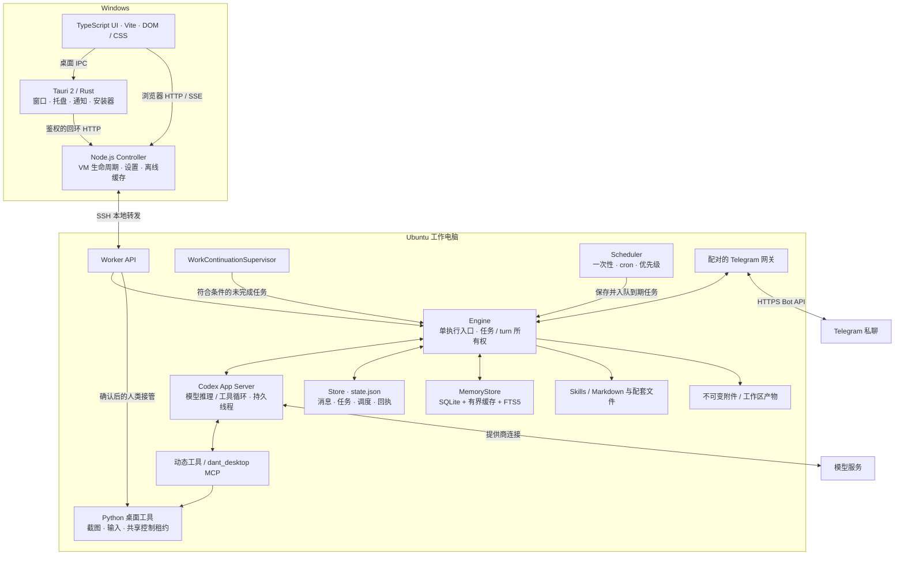
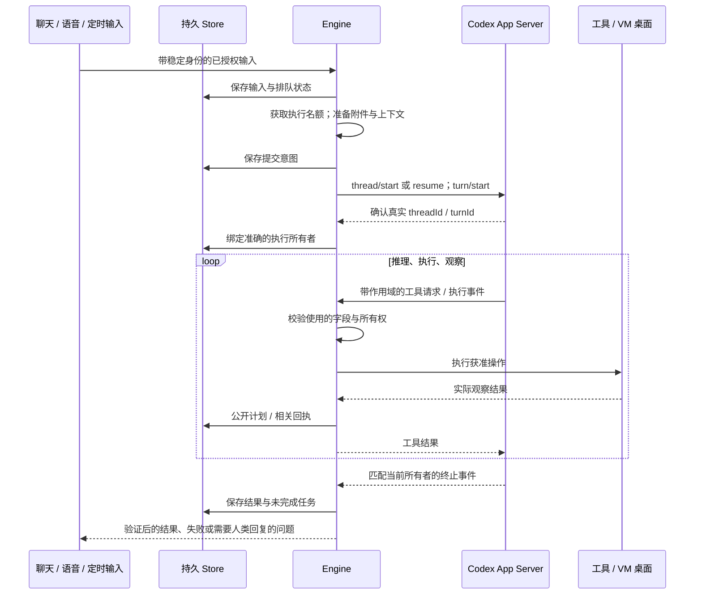
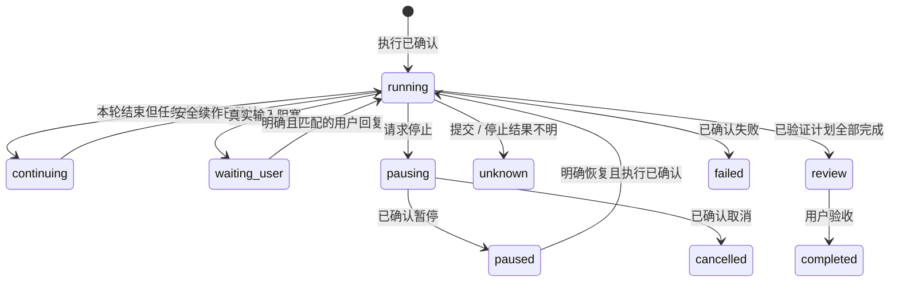
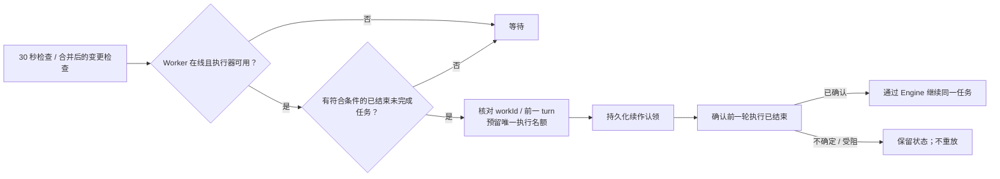
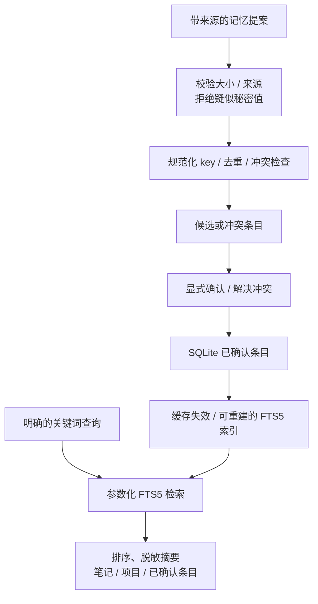

# 系统架构

[English](../architecture.md) · Chinese

dant 是本地优先的桌面 Agent。Tauri 2 提供 Windows 宿主，Controller 管理工作电脑，Ubuntu Worker 负责执行和对话数据。本文描述当前源码，包括本次 SQLite 记忆迁移；已发布的安装包可能仍是较早的实现。

## 总体系统

UI 展示状态并提交操作。Controller **不会创建 Engine，也不会在 Windows 上执行 Agent 任务**。Worker 必须在有可用图形桌面的 Linux VM 内，以普通用户身份启动。UI 断开不会把 Controller 变成执行器。

| 组件        | 源码                                                            | 职责                                               |
| ----------- | --------------------------------------------------------------- | -------------------------------------------------- |
| 原生宿主    | `src-tauri/src/`                                                | 窗口、托盘、原生 IPC、通知、安全宿主集成、安装交接 |
| 应用组装    | [`src/app/`](../../src/app/)                                    | Controller/Worker 模式、API 与服务所有权           |
| 运行时通信  | [`src/runtime/`](../../src/runtime/)                            | Codex 进程、JSON-RPC、事件校验与响应所有权         |
| Agent 执行  | [`engine.mts`](../../src/work/engine.mts)                       | 接纳输入、绑定确认的 turn、处理工具、保存结果      |
| 任务连续性  | [`src/work/`](../../src/work/)                                  | 计划、回复、暂停/取消、项目上下文与安全续作        |
| Heartbeat   | [`work-continuation.mts`](../../src/work/work-continuation.mts) | 判断已结束执行但未完成的任务能否继续               |
| 调度器      | [`scheduler.mts`](../../src/schedules/scheduler.mts)            | 执行时间、重复规则、优先级和派发回执               |
| 记忆 / 对话 | [`src/conversation/`](../../src/conversation/)                  | Store、共享参考上下文、SQLite 记忆与迁移           |
| 电脑控制    | [`src/computer/`](../../src/computer/)、`vm/`                   | VM 部署、SSH、截图、输入和控制权                   |

运行时模块使用 Node 原生可擦除类型的 TypeScript（`.mts`），纯类型放在 `.ts`。前端使用 Vite、TypeScript 和 DOM/CSS。模块与测试目录遵循[代码规范](code-style.md)。当前是 npm 仓库，尚未改成 React 应用或 pnpm workspace monorepo。

## Agent loop 与执行所有权

**Codex App Server 负责模型推理、工具迭代和模型对话；dant Engine 负责执行准入、持久化、身份、确认和交付。** 应用没有另起一个按固定间隔调用 LLM 的循环。

`Engine.pump()` 选择排队任务，线程初始化恢复当前对话对应的 Codex 线程，`handle()` 分派有作用域的事件/工具，`complete()` 保存结果和附件。提前到达的事件有界保存，不能在有效 `turn/start` 确认之前证明执行归属。提交状态和任务状态是 [`states.mts`](../../src/contracts/states.mts) 中的不同状态域。

持久 `workId` 可以跨 turn 保留。`task_plan` 记录真实步骤，`task_list` 和 `task_cancel` 使用已保存身份。回复任务时，普通聊天输入携带 `workId`、预期 turn 和对话 ID；执行中的回复只送给匹配所有者，已结束任务则带着保留的项目上下文，从同一入口重开。

此图概括持久任务，不是所有聊天通信状态。回复结束、消息已读、计划完成、用户验收是不同事件。重启后，中断或不确定的执行会暂停。结果未知时必须先核实实际状态再提交；请求超时不能证明操作从未发生。

## Heartbeat 与 Scheduler

**Heartbeat 用来继续已有的授权任务，不是定时汇报进度。** 如果任务已经在执行，就继续原来的执行；supervisor 不会再开一轮，也不会添加 heartbeat 消息。

| 机制                  | 时机                               | 行为                                 |
| --------------------- | ---------------------------------- | ------------------------------------ |
| 未完成任务 supervisor | 每 30 秒；Engine 变更合并后约 5 秒 | 检查执行条件，最多接纳一个续作       |
| 调度时钟              | 每 1 秒                            | 检查一次性/cron 任务是否到期并入队   |
| 当前执行              | Codex 事件驱动                     | 持续推理和使用工具，不等待 heartbeat |

空闲检查不调用 LLM。暂停、取消、等待用户、待验收和结果不确定的任务不会自动续作。离线、执行器忙碌和用户接管也会阻止准入。符合条件的任务按优先级、到期时间和稳定的保存顺序选择，优先级不会抢占当前任务。

续作在异步提交前保存认领，并再次核对准确的任务/turn。自动续作中的普通叙述与交付先缓冲，只有完成、失败或真实输入阻塞才合并发布结果。连续三轮没有进展会暂停任务；新的有效执行证据可以允许有限延长，重复观察和失败动作不算进展。延长上限不等于通用的模型工具步数或 token 预算。

调度支持一次性时间点和按 IANA 时区计算的五字段 cron。错过重复任务最多补跑一次，再计算未来时间；同一调度不会与自身未完成任务重叠。派发先把认领与排队消息一起保存，再进入执行器；稳定的创建请求 ID 和删除记录防止确认不明时重复创建。调度目前保存在 `state.json`，尚未迁入 SQLite 租约表。

当前没有另一套每 15 分钟自主创建目标的 AI heartbeat。后续增加主动事件来源，也必须经过明确条件、去重和同一执行入口。

## Memory：存储、缓存与召回

SQLite 管理持久记忆，不替代 Codex 原始对话，也不管理应用的所有记录。当前直接使用内置 `node:sqlite`，无需独立数据库服务。

| 记忆类型          | 当前实现                                       | 持久数据权威                             |
| ----------------- | ---------------------------------------------- | ---------------------------------------- |
| Working Memory    | Engine 当前状态、任务检查点、复用的 Codex 线程 | `state.json` 与 Codex 线程，配合进程状态 |
| Episodic Memory   | 按对话/任务 ID 保留的项目上下文；显式经历条目  | `memory.sqlite`                          |
| Semantic Memory   | 身份/工作参考笔记；已确认的事实与偏好          | `memory.sqlite`                          |
| Procedural Memory | 托管 `SKILL.md` 及必要的配套文件               | 现有 Skills 存储 / Markdown              |

历史名称 `working-memory.md` 保留为持久参考笔记的兼容标签，不代表完整的实时 Working Memory。助手共同身份来自 [`identity.mts`](../../src/conversation/identity.mts)，与用户参考记忆分开。记忆不能授权工具或启动任务。

### 持久存储与缓存

`~/dant/data/memory/dant/memory.sqlite` 包含 `notes`、`projects`、`memory_entries`、修订信息和 FTS5 索引。`MemoryStore` 是统一入口，[`memory-sqlite.mts`](../../src/conversation/memory-sqlite.mts) 负责事务，[`memory-markdown.mts`](../../src/conversation/memory-markdown.mts) 负责显式 Markdown 导入导出。

每次读取在同一 SQLite 读事务中检查持久 revision，再决定是否复用笔记、确认条目或项目缓存。表触发器在数据变化时增加 revision，其他连接的写入也能使缓存失效；本地写入主动失效缓存。返回记录使用副本，项目缓存有数量上限，短连接在每次事务后释放句柄。缓存不能成为另一份数据权威。

数据库启用 schema 版本、外键检查、有界忙等待、`synchronous=FULL`，采用 **DELETE journal**。当前没有直接开启 WAL，因为声明支持的较早 Node/SQLite 基线需要兼容；切换应先约束 SQLite 版本并验证并发。参见 [Node SQLite](https://nodejs.org/api/sqlite.html) 和 [SQLite WAL](https://www.sqlite.org/wal.html)。

迁移先校验并备份旧 Markdown/项目 JSON，再导入。保留项目原 ID 和已有来源时间，不补造缺失时间。随后 SQLite 成为数据权威，修改 `.md` 快照不会静默覆盖数据库，导入导出需要显式调用。任务 JSON 可以保留历史项目快照，但回复任务时通过绑定的 SQLite adapter 读取当前上下文。迁移失败保留来源，并停止失败操作。

### Consolidation 与检索

`proposeEntry`、`confirmEntry`、`updateEntry` 和 `deleteEntry` 实现存储流程。条目保留来源类型、已知的对话/任务/消息引用、提供的置信度及真实创建/更新时间。候选和冲突条目不进入有效上下文或检索；冲突必须明确解决，编辑已确认条目后需要重新确认。疑似凭据会被拒绝，供模型使用的参考文本会清理和脱敏。这些控制不代表任意敏感资料都适合保存。

`search(query)` 在笔记、项目上下文、已确认 semantic/episodic 条目中提供有界关键词召回。FTS 使用参数绑定和字面关键词，索引可重建，支持中文关键词。目前没有 embeddings 或向量检索。

当前 prompt 包含安全的身份/工作笔记，以及最多 32 条最新确认条目；回复项目任务时还读取对应项目上下文。**FTS 目前是显式 MemoryStore API，尚未用于每条消息或 heartbeat 的自动召回。** 候选增删改查也是程序接口，现有 Memory & personality 页面仍只读展示有效上下文。完整编辑界面、自动候选提取、按相关性/新近程度/置信度综合排序仍需集成。兼容的 `memory_write` 工具仍直接编辑参考笔记，尚未统一改成结构化候选确认流程。

Codex 管理模型线程、上下文窗口、压缩和提供商 token 统计。dant 不会把全部聊天转成语义记忆，也不会用截短的 UI 历史重建线程。参见[上下文](context.md)。

## 工具、鉴权与电脑控制权

工具 schema 与 handler 支持桌面、计划、调度、凭据和 Skills，包括 `dant_desktop` MCP。网页、文件和记忆是参考数据，不是权限。运行时解码器负责校验未知磁盘/网络数据的实际使用字段，TypeScript 类型本身不能完成校验。

Controller 与 Worker 默认各自在本机绑定 `127.0.0.1:4317`，VM 桌面服务默认 `127.0.0.1:4320`。共享配置校验部署选项，开发 `.env` 可选，安装包有默认值。参见[配置](configuration.md)。

API 使用 `X-Dant-Token`、host/origin 检查和固定原生端点描述符。**Token 用于鉴权，不会加密 HTTP。** Controller/Worker 流量经 SSH 本地转发；模型/Telegram 使用各自的加密通信。API 不暴露到 VM 网卡。Token 和秘密不进入公开快照、日志或记忆；VM vault 与 Windows DPAPI 各自负责相应凭据。

当前 Codex 在 VM 内使用 `approvalPolicy: 'never'` 和 `danger-full-access`。实际边界包括 VM、普通用户、受限文件接口、鉴权和桌面租约。**当前没有覆盖所有模型 shell 操作的独立通用 Policy Engine，也没有逐命令/逐删除审批。** Tauri capabilities 限制原生 bridge，不会限制 Node Worker 的全部权限。更强的工具策略与审批需要单独实现。

用户接管先预留控制权，中断准确 turn，确认停止后才授予 VM 控制租约。Python 工具与 UI 输入共用锁/租约，过期或不匹配的 session 不能输入；归还控制权不会重放暂停任务。这些控制不能保证杀死此前脱离的后台进程，也不能替代系统权限。

## 数据与生命周期

| 所有者             | 数据                                               | 恢复规则                                     |
| ------------------ | -------------------------------------------------- | -------------------------------------------- |
| Windows Controller | 连接/部署回执、设置、离线 `state-cache.json`       | 展示缓存不能启用宿主任务执行                 |
| Worker Store       | `state.json`：消息、任务、调度、已读/交付/提交回执 | 保留身份，暂停中断/不确定执行                |
| Worker Memory      | `memory/dant/memory.sqlite`、显式导出、迁移备份    | 事务 + revision 缓存；旧文件不是实时数据权威 |
| Worker 文件        | 不可变 UUID 附件、对话工作区/产物                  | 有界归档，交付保存独立副本                   |
| Codex 运行时       | 持久线程与私有对话                                 | 只恢复匹配对话/运行时的线程                  |
| 凭据               | 受限 VM vault、相应的 Windows DPAPI 秘密           | 普通状态导出不含秘密原值                     |

托盘初始化成功时，关主窗口会隐藏到托盘；托盘不可用则回退为正常关闭。明确 Exit 会先暂停任务、确认停止，再挂起本应用拥有的 VM。重新打开恢复 VM，不会悄悄恢复暂停任务。服务更新保持 VM 开机，在暂停任务后替换并验证版本；安装交接还增加执行准入租约及进程/VM 所有权检查。关窗口可以继续后台工作，但 **Exit 后 VM 挂起或宿主休眠时不能继续执行**。参见 [VM](VM.md) 和[更新](updates.md)。

通话媒体与任务身份分开：正常挂断可以保留已接纳任务，关闭结果不明不能证明任务已停。浮动通话窗口只转发限定控制，不拥有另一套麦克风/执行器。Telegram 共享 Store 和 Engine，使用稳定输入 ID、配对和持久发送回执，不会另建运行时。参见[语音](VOICE-KEY.md)、[共享上下文](context.md)与 [Telegram](TELEGRAM.md)。

## 当前边界与后续工作

以下决策指导后续实现，保留现有执行架构，不再增加一套 Agent 运行时。

| 模块                       | 决策                     | 下一步                                                |
| -------------------------- | ------------------------ | ----------------------------------------------------- |
| Controller / Worker        | 保留职责边界             | 执行与持久对话的数据权威仍在 Worker                   |
| Codex App Server           | 保留模型/工具循环        | 扩展编排，不重复实现推理循环                          |
| Single execution admission | 保留单执行权             | 新输入来源统一经过现有准入和确认检查                  |
| Heartbeat                  | 保留当前续作设计         | 继续符合条件的未完成任务，不定时发聊天汇报            |
| Scheduler                  | 暂时保持当前存储         | 保留重复、补跑和防重叠行为，暂不迁入 SQL              |
| MemoryStore                | **第一优先级：自动检索** | 将有界、带作用域的 FTS 召回接入上下文构造             |
| SQLite + FTS5              | 保留关键词检索           | 当前不引入独立 Vector DB                              |
| VM 跨平台                  | 进一步抽象 Provider      | 把生命周期能力与 Windows 的 Hyper-V / VMware 适配分开 |
| Tool security              | 增加独立权限控制         | 覆盖所有执行路径，包括 Codex 内置工具和 MCP           |

自动检索应使用当前用户请求或选中任务的真实上下文，在正确的对话/项目范围查询已确认记忆，注入有长度限制、脱敏且带来源的参考内容。候选不能混入，明确身份/偏好要保留，修改和删除后召回结果必须失效。空闲 heartbeat 不能仅因计时器触发就检索或推理。验收需覆盖跨项目隔离、无匹配、旧缓存、已删除/冲突事实，以及用户内容保持原样。这是下一阶段的集成目标，不是当前已实现的行为。

独立权限服务应在**执行前**校验真实工具、参数、任务/turn 所有者和获准资源，再允许、拒绝或保存审批请求。审批绑定具体操作，参数或所有者变化后必须失效。必须同时覆盖 Codex 内置 shell/文件操作和应用工具；只拦动态工具会留下绕过路径。这需要调整当前执行/审批配置，并验证被拒操作和审批结果不明的情形，不能新增第二套 Agent loop，也不能把模型文字、记忆或网页内容当成权限。

参考架构用于指导边界，不代表其中的提案已经全部实现：

- SQLite 当前覆盖记忆，没有把消息、task runs、事件、审批和调度统一迁到 SQL。
- 已有续作保护、停止控制、超时和有界证据延长；统一的每任务工具步数、执行时间和 token 预算仍需设计。
- 已有关键词检索与候选存储；自动召回、记忆编辑器、embeddings 和自动 consolidation 需要集成与验证。
- 已有 Windows Controller / Ubuntu Worker 生命周期，尚未实现通过 named pipes/Unix sockets 通信的跨平台独立用户服务。
- 已有 TypeScript 合约与运行时校验；React、Zustand、Tailwind、Zod 和 pnpm monorepo 不是当前依赖。

模块测试使用隔离 Store、注入时钟/通信和 fixture 执行器，验证所有权、持久化、不确定结果和恢复，不操作用户真实 VM 或账号。通过测试不能证明真实音频质量、通知送达或桌面任务成功。检查命令与验收记录见 [CI](ci.md)和[验证](verification.md)。
