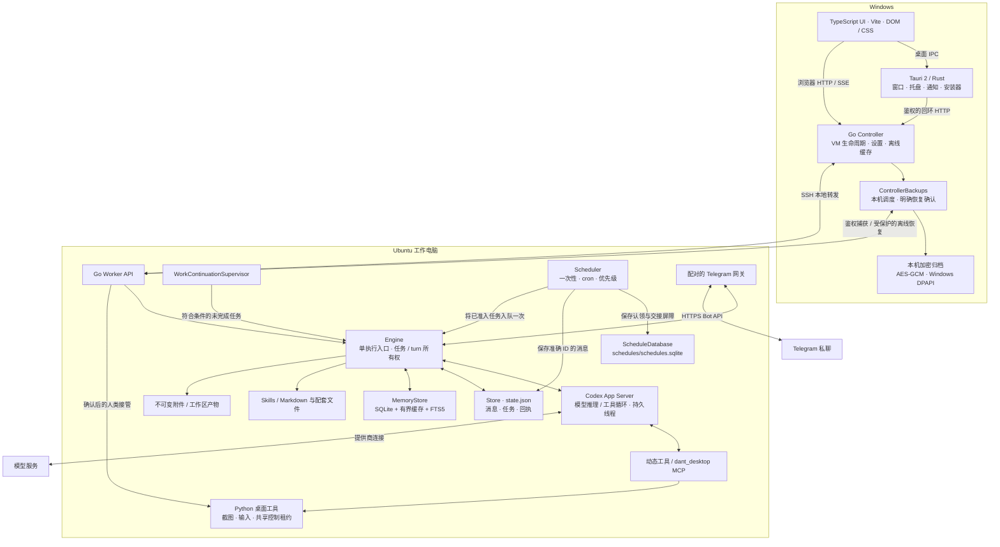
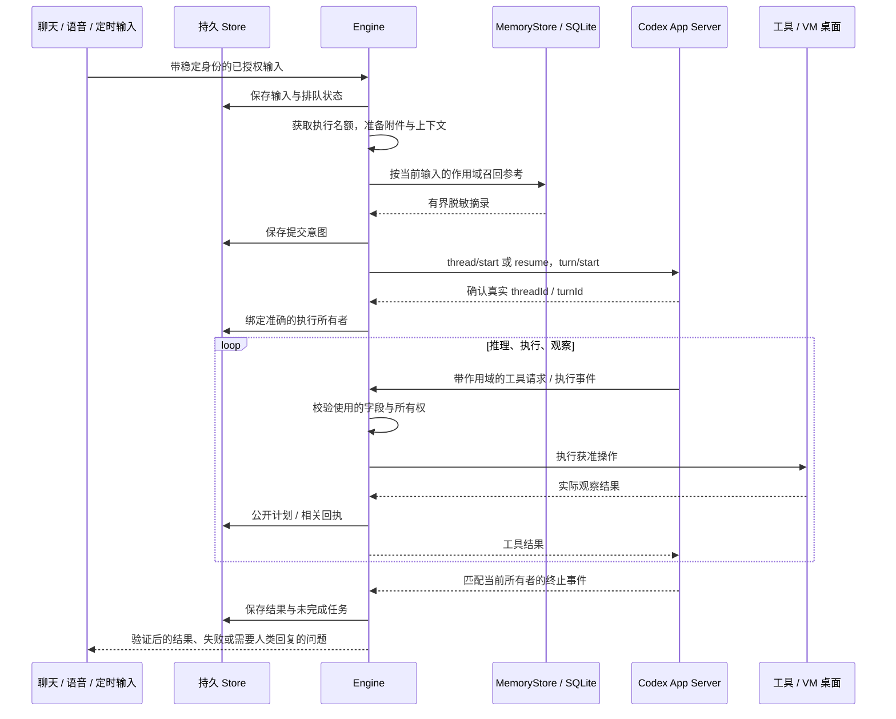
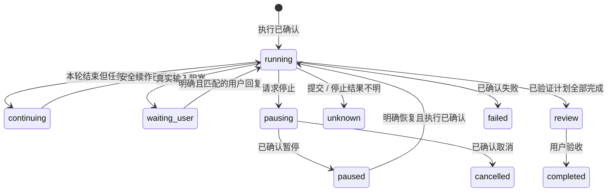
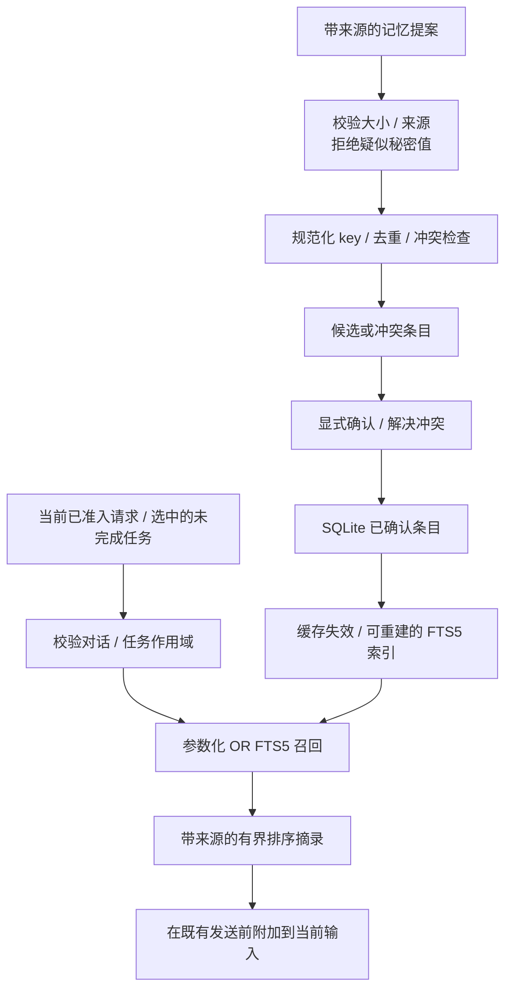

# 系统架构

[English](../architecture.md) · Chinese

dant 是本地优先的桌面 Agent。Tauri 2 提供 Windows 宿主，Controller 管理工作电脑，Ubuntu Worker 负责执行和对话数据。本文描述当前源码，包括带作用域的记忆召回、SQLite 调度与本地加密备份；已发布的安装包可能仍是较早的实现。

dant 使用 **Go Core + Rust Tauri + TypeScript UI**。独立 Go Controller 与 Worker 角色负责全部后端，TypeScript 负责浏览器与构建工具。共享 schema、协议默认值与语言数据位于 `resources/`。参见[运行支持](runtime-support.md)和 [Go Core](go-core.md)。

## 总体系统

UI 展示状态并提交操作。Controller **不会创建 Engine，也不会在 Windows 上执行 Agent 任务**。Worker 必须在有可用图形桌面的 Linux VM 内，以普通用户身份启动。UI 断开不会把 Controller 变成执行器。

公开状态中的集合即使为空也使用 JSON 数组。Worker 快照和旧版 Controller 缓存的展示副本将缺省定时任务显示为 `[]`，不会改写持久状态或增加其版本号。未知的集合类型仍会被校验拒绝。

消息的 Pin 和 Star 操作通过绑定当前聊天的元数据接口，更新原有消息上的布尔标记。操作保留执行器持有的消息引用，不标为已读、不向模型发送输入，也不授权新工作。聊天菜单提供搜索、收藏消息和媒体／文档／HTTP 链接浏览，定位时先通过历史窗口展开准确的原消息。只有存在置顶消息时才显示顶部摘要。

聊天先渲染最近 80 条消息，向上浏览时按批次追加旧消息。阅读历史期间固定首条边界，避免新消息挤掉当前位置；切换聊天或 VM 后重置窗口。回复、搜索和任务结果先展开准确的旧消息，再定位焦点。只有实际渲染的消息才可能标为已读。这减少 DOM 和 Markdown 的处理量，当前状态传输仍包含完整聊天。相同状态跳过重复渲染，净化后的 Markdown 使用有上限的缓存，时间随当前系统时区更新。后台 GET 请求独立执行，修改操作仍保留顺序及旧结果保护。

| 组件           | 源码                                                                                                      | 职责                                                              |
| -------------- | --------------------------------------------------------------------------------------------------------- | ----------------------------------------------------------------- |
| 原生宿主       | `src-tauri/src/`                                                                                          | 窗口、托盘、原生 IPC、通知、安全宿主集成、安装交接                |
| 应用组装       | [`core/internal/app/`](../../core/internal/app/)                                                          | Worker API 与服务所有权，宿主组装位于 `core/internal/controller/` |
| 运行时通信     | [`core/internal/runtime/`](../../core/internal/runtime/)                                                  | Codex 进程、JSON-RPC、事件校验与响应所有权                        |
| Agent 执行     | [`Engine`](../../core/internal/work/engine.go)                                                            | 接纳输入、绑定确认的 turn、处理工具、保存结果                     |
| 任务连续性     | [`core/internal/work/`](../../core/internal/work/)                                                        | 计划、回复、暂停/取消、项目上下文与安全续作                       |
| Heartbeat      | [`Supervisor`](../../core/internal/work/supervisor.go)                                                    | 判断已结束执行但未完成的任务能否继续                              |
| 调度器         | [`Scheduler`](../../core/internal/schedules/scheduler.go)                                                 | 执行时间、重复规则、优先级和派发回执                              |
| 记忆 / 对话    | [`core/internal/memory/`](../../core/internal/memory/)                                                    | SQLite 记忆、召回与迁移，对话权威位于 `core/internal/store/`      |
| 电脑控制       | [`core/internal/computer/`](../../core/internal/computer/)、`vm/`                                         | VM 部署、SSH、截图、输入和控制权                                  |
| 宿主 / VM 适配 | [`core/internal/platform/`](../../core/internal/platform/)、[`providers/`](../../core/internal/computer/) | 宿主能力及提供商的检测/创建/生命周期命令                          |
| 本地备份       | [`core/internal/backups/`](../../core/internal/backups/)                                                  | Controller 加密归档、Worker 快照与明确的离线恢复                  |

生产后端位于 `core/internal/`，通过 `application` 由小型 `core/cmd/dant-core` 入口组装。Controller 与 Worker 是编译后二进制的独立角色。前端使用 Vite、TypeScript 和 DOM/CSS。跨语言输入分别归属 `resources/contracts/`、`resources/config/`、`resources/i18n/`，生成的 Go 与 UI 契约都检查漂移。全部 Go 测试放在对应包结构的 `tests/go/`。模块与测试归属遵循[代码规范](code-style.md)。

## Agent loop 与执行所有权

**Codex App Server 负责模型推理、工具迭代和模型对话；dant Engine 负责执行准入、持久化、身份、确认和交付。** 应用没有另起一个按固定间隔调用 LLM 的循环。

Go Engine 选择排队任务，恢复当前对话对应的 Codex 线程，分派有作用域的事件和工具，并保存结果及附件。提前到达的事件有界保存，不能在有效 `turn/start` 确认之前证明执行归属。提交状态和任务状态由共享[状态 schema](../../resources/contracts/state-domains.json) 定义，生成到 Go 与 [`states.mts`](../../ui/shared/states.mts) 中的不同状态域。

Go 的并发用于传输和编排，仍然只有一个执行权持有者。Engine 拥有可取消的生命周期、唤醒 channel、有界输入队列、工具并发槽和退出时等待的 worker。Memory 和 Scheduler 的事务、SQL 与行映射留在所属仓储，不进入 UI 或进程入口。网络取消仍保留请求、连接、任务和 turn 的精确身份，不能把未知副作用改成可重试。生产程序禁用 CGO；延迟测量和设备验收需要各自的证据。

持久 `workId` 可以跨 turn 保留。`task_plan` 记录真实步骤，`task_list` 和 `task_cancel` 使用已保存身份。回复任务时，普通聊天输入携带 `workId`、预期 turn 和对话 ID；执行中的回复只送给匹配所有者，已结束任务则带着保留的项目上下文，从同一入口重开。

明确点击 Resume 时，只认领选中的已知暂停任务、对应对话和上一轮 turn。提交续作前，先确认当前执行器已停止，再读取匹配且空闲的线程并检查各轮结束状态。早于该任务、且不属于其执行归属的不确定历史消息可以继续保留未确认状态，不重放，也不宣称成功。相关或较新的不确定消息、不确定的持久任务、人工接管、待处理准入或未确认停止仍会阻止恢复。自动续作继续采用全局不确定状态屏障。暂停和取消会等待正在进行的准备工作结束，并停止已确认的续作 turn，包括停止期间才到达的执行确认。

续接检查只读取线程元数据，并以 `itemsView: "notLoaded"` 分页遍历完整 turn 清单，不加载历史截图或工具条目。每页必须有大小上限、唯一且已终止的 turn ID，以及有效、不重复的游标，并在 turn 数、页数、字节数和时间上限内到达明确的结束位置。清单必须包含原 turn。提交唯一的新 turn 前仍需重新读取匹配的空闲线程，并核对当前所有者；清单不完整或已过期时停止准备，不提交任务。

工作进度以独立滚动的面板打开，位于聊天和 Computer 之间。顶部按钮采用相同顺序，响应式布局让面板留在页面正常布局中。移除或取消任务时，确认操作显示在对应任务卡内，不把焦点移到列表顶部。

工作进度在实际验收时间经过三天后隐藏已确认完成的条目。执行轮次结束、旧请求时间或已完成的检查清单都不能代替验收时间；缺少有效验收时间的旧记录继续显示。待验收、等待回复、暂停、失败和状态未确认的工作仍然保留。这只影响展示，聊天、任务身份、项目记忆和重开引用不会删除。现有在线状态计时器会在下一项条目到期时刷新当前可见的进度面板。

此图概括持久任务，不是所有聊天通信状态。回复结束、消息已读、计划完成、用户验收是不同事件。重启后，中断或不确定的执行会暂停。结果未知时必须先核实实际状态再提交；请求超时不能证明操作从未发生。

## Heartbeat 与 Scheduler

**Heartbeat 用来继续已有的授权任务，不是定时汇报进度。** 如果任务已经在执行，就继续原来的执行；supervisor 不会再开一轮，也不会添加 heartbeat 消息。

| 机制                  | 时机                               | 行为                                 |
| --------------------- | ---------------------------------- | ------------------------------------ |
| 未完成任务 supervisor | 每 30 秒；Engine 变更合并后约 5 秒 | 检查执行条件，最多接纳一个续作       |
| 调度时钟              | 每 1 秒                            | 检查一次性/cron 任务是否到期并入队   |
| 当前执行              | Codex 事件驱动                     | 持续推理和使用工具，不等待 heartbeat |

空闲检查不调用 LLM。暂停、取消、等待用户、待验收和结果不确定的任务不会自动续作。离线、执行器忙碌和用户接管也会阻止准入。符合条件的任务按优先级、到期时间和稳定的保存顺序选择，优先级不会抢占当前任务。

续作在异步提交前保存认领，并再次核对准确的任务/turn。自动续作中的普通叙述与交付先缓冲，只有完成、失败或真实输入阻塞才合并发布结果。连续三轮没有进展会暂停任务；新的有效执行证据可以允许有限延长，重复观察和失败动作不算进展。延长上限不等于通用的模型工具步数或 token 预算。

调度支持一次性时间点和按 IANA 时区计算的五字段 cron。错过重复任务最多补跑一次，再计算未来时间；同一调度不会与自身未完成任务重叠。[`ScheduleDatabase`](../../core/internal/schedules/database.go) 在 `~/dant/data/schedules/schedules.sqlite` 保存调度、创建请求删除记录和派发回执。旧 JSON 调度先备份、仅导入一次，之后旧快照不能复活已删除或已修改的任务。修订号比较并交换（CAS）防止编辑覆盖，调度/执行时间的唯一键保证跨实例只认领一次。

| 派发阶段       | 含义                                                       |
| -------------- | ---------------------------------------------------------- |
| `prepared`     | SQLite 已保存认领与不可变消息身份，JSON 消息可能尚未存在。 |
| `materialized` | 相同 ID 的消息已保存到 JSON，尚未交给执行器。              |
| `held`         | 恢复时只允许补存同一条消息，不将它入队。                   |
| `handed-off`   | 入队前已提交禁止重放的屏障，回执丢失不能授权再次派发。     |

聊天消息仍由 `state.json` 保存。短 SQLite 写事务串行完成准确 ID 的 JSON 消息补写与阶段更新，但两个文件并不构成一笔原子数据库事务。重启只把尚未交接的认领恢复为同 ID 的暂停消息，已有不确定/提交中观察继续保留。交接屏障已保存后，即使入队抛错或 JSON 消息缺失，也不会自动重放；屏障不代表执行成功。其他完整会话写入仍遵循单 Worker 所有者规则。

当前没有另一套每 15 分钟自主创建目标的 AI heartbeat。后续增加主动事件来源，也必须经过明确条件、去重和同一执行入口。

## Memory：存储、缓存与召回

SQLite 管理持久记忆，不替代 Codex 原始对话，也不管理应用的所有记录。Go Memory 通过 `database/sql` 使用固定版本的纯 Go `modernc.org/sqlite`，不需要独立数据库服务或 CGO 运行库。

| 记忆类型          | 当前实现                                       | 持久数据权威                             |
| ----------------- | ---------------------------------------------- | ---------------------------------------- |
| Working Memory    | Engine 当前状态、任务检查点、复用的 Codex 线程 | `state.json` 与 Codex 线程，配合进程状态 |
| Episodic Memory   | 按对话/任务 ID 保留的项目上下文；显式经历条目  | `memory.sqlite`                          |
| Semantic Memory   | 身份/工作参考笔记；已确认的事实与偏好          | `memory.sqlite`                          |
| Procedural Memory | 托管 `SKILL.md` 及必要的配套文件               | 现有 Skills 存储 / Markdown              |

历史名称 `working-memory.md` 保留为持久参考笔记的兼容标签，不代表完整的实时 Working Memory。助手共同身份来自 [`identity.go`](../../core/internal/memory/identity.go)，与用户参考记忆分开。记忆不能授权工具或启动任务。

### 持久存储与缓存

`~/dant/data/memory/dant/memory.sqlite` 包含 `notes`、`projects`、`memory_entries`、修订信息和 FTS5 索引。Go `memory.Store` 是唯一生产入口，[`Store`](../../core/internal/memory/store.go) 负责事务，[`Markdown interchange`](../../core/internal/memory/store_notes.go) 负责显式 Markdown 导入导出。

每次读取在同一 SQLite 读事务中检查持久 revision，再决定是否复用笔记、确认条目或项目缓存。表触发器在数据变化时增加 revision，其他连接的写入也能使缓存失效；本地写入主动失效缓存。返回记录使用副本，项目缓存有数量上限，短连接在每次事务后释放句柄。缓存不能成为另一份数据权威。

数据库启用 schema 版本、外键检查、有界忙等待、`synchronous=FULL`，采用 **DELETE journal**。DELETE journal 属于磁盘和备份契约。启用 WAL 需要另外验证并发和恢复行为，参见 [SQLite WAL](https://www.sqlite.org/wal.html)。

迁移先校验并备份旧 Markdown/项目 JSON，再导入。保留项目原 ID 和已有来源时间，不补造缺失时间。随后 SQLite 成为数据权威，修改 `.md` 快照不会静默覆盖数据库，导入导出需要显式调用。任务 JSON 可以保留历史项目快照，但回复任务时通过绑定的 SQLite adapter 读取当前上下文。迁移失败保留来源，并停止失败操作。

记忆设置页通过已有鉴权保护的 `/api/memory/manage` 管理 SQLite 权威文档及结构化事实／经历。逻辑文档 ID 显示为文档标签，不冒充文件来源。关键词搜索在 FTS 数量限制前筛选项目及条目的作用域，共享文档仍属全局。列表分页，来源与任务身份保持不变；助手共享人格单独只读展示。编辑、清空、删除及显式确认候选时，在写事务内比较读取时的数据库 revision。编辑结构化事实会重新进入候选审核，不会静默替换冲突的已确认事实。已脱敏记录不能通过编辑覆盖隐藏的原文。写入断连或结果未确认时不自动重试，界面要求先重新读取权威数据再操作。旧只读 `/api/memory/view` 保留兼容。

### Consolidation 与检索

`Store.Propose`、`Store.Confirm`、`Store.Update` 和 `Store.Delete` 实现存储流程。条目保留来源类型、已知的对话/任务/消息引用、提供的置信度及真实创建/更新时间。候选和冲突条目不进入有效上下文或检索；冲突必须明确解决，编辑已确认条目后需要重新确认。疑似凭据会被拒绝，供模型使用的参考文本会清理和脱敏。这些控制不代表任意敏感资料都适合保存。

`search(query)` 继续提供显式、有界的关键词 API。自动 [`retrieve(query, scope)`](../../core/internal/memory/store_search.go) 规范化有界的当前查询，去掉常见填充词，再以 **OR** 组合字面关键词进行参数化 FTS5 检索。作用域过滤先于排序与数量限制：共享笔记和无作用域的已确认语义事实可用；带来源范围的事实必须匹配当前对话/任务，项目上下文还必须匹配选中的工作 ID。候选、冲突条目和其他项目不进入结果。支持中文关键词，不使用 embeddings 或向量检索。

Agent 基础记忆上下文只包含安全的身份/工作笔记。`context()` 中最多 32 条确认条目的视图保留用于兼容/只读展示，不再整批注入每个 Agent prompt。[`Store.AgentContext`](../../core/internal/memory/store_search.go) 为**当前已经准入的输入**附加最多六条有界、脱敏且带来源的参考。普通执行轮次、任务调整、自动续作、识别后的音频以及原生/API 通话文字，都在既有发送前读取最新记忆；API 语音任务委派沿用相同 Engine 输入路径。没有匹配时原输入保持不变。修订检查使修改、删除和冲突变化立即可见，不保留独立的召回结果缓存。

召回不修改用户原消息，也不增加另一项推理请求、执行轮次或持久参考注入操作；它不能授权动作或恢复其他任务。Codex 旧历史不会被清除，参考标记明确限定当前输入，并在该输入中取代旧摘录。空闲 heartbeat 检查不检索记忆。记忆与人格页面提供上文所述、经校验的文档与条目管理；自动提取／整理尚未实现。兼容的 `memory_write` 仍直接编辑参考笔记。

Codex 管理模型线程、上下文窗口、压缩和提供商 token 统计。dant 不会把全部聊天转成语义记忆，也不会用截短的 UI 历史重建线程。参见[上下文](context.md)。

## 工具、鉴权与电脑控制权

工具 schema 与 handler 支持桌面、计划、调度、凭据和 Skills，包括 `dant_desktop` MCP。网页、文件和记忆是参考数据，不是权限。Go 与浏览器边界解码器负责校验未知磁盘/网络数据的实际使用字段，静态类型不能替代运行时校验。

Controller 与 Worker 默认各自在本机绑定 `127.0.0.1:4317`，VM 桌面服务默认 `127.0.0.1:4321`。共享配置校验部署选项，开发 `.env` 可选，安装包有默认值。参见[配置](configuration.md)。

API 使用 `X-Dant-Token`、host/origin 检查和固定原生端点描述符。**Token 用于鉴权，不会加密 HTTP。** Controller/Worker 流量经 SSH 本地转发；模型/Telegram 使用各自的加密通信。API 不暴露到 VM 网卡。Token 和秘密不进入公开快照、日志或记忆；VM vault 与 Windows DPAPI 各自负责相应凭据。

当前 Codex 在 VM 内使用 `approvalPolicy: 'never'` 和 `danger-full-access`。实际边界包括 VM、普通用户、受限文件接口、鉴权和桌面租约。**当前没有覆盖所有模型 shell 操作的独立通用 Policy Engine，也没有逐命令/逐删除审批。** Tauri capabilities 限制原生 bridge，不会限制 Worker 的全部执行路径。更强的工具策略与审批需要单独实现。

用户接管先预留控制权，中断准确 turn，确认停止后才授予 VM 控制租约。Python 工具与 UI 输入共用锁/租约，过期或不匹配的 session 不能输入；归还控制权不会重放暂停任务。这些控制不能保证杀死此前脱离的后台进程，也不能替代系统权限。

确认人工租约期间，新发送的普通聊天使用独立、临时的对话进程，不能注册任务、调用工具、恢复旧工作或替换已保存的任务线程。Bubblewrap 仅开放私有 home/config/work 目录、只读运行库和最少的网络配置，原用户文件、桌面套接字和服务令牌均不可见。固定版本的 app-server 不获得执行环境或动态工具。环境变量提供的固定模型服务沿用当前账号原有推理地址，不建立受管理登录，也不继承原配置或云配置。凭据仅在子进程的受限生命周期内通过环境传入，不复制到认证文件。确认进程退出并等待回收后才删除私有目录、释放准入；提交结果未知时不会重放。

命名空间的根文件系统为只读，home/config/work 使用独立的可写挂载。固定的 `/etc/codex/requirements.toml` 包含空的 `[mcp_servers]` 表，私有工作目录不能重命名或替换其策略父目录。新建 VM 会安装系统 `bubblewrap` 软件包。现有 VM 需要先安装该 Ubuntu 软件包并通过命名空间预检，更新器才会停止当前 Worker；更新器不会自动执行 `sudo`，也不会用用户目录中的二进制替代系统安全配置。缺少依赖或命名空间被阻止时，会保留正在运行的版本。

## 数据与生命周期

| 所有者             | 数据                                            | 恢复规则                                       |
| ------------------ | ----------------------------------------------- | ---------------------------------------------- |
| Windows Controller | 连接/部署回执、设置、离线 `state-cache.json`    | 展示缓存不能启用宿主任务执行                   |
| Controller 备份    | `backup-settings.json`、`vm-backups/*.dantbak`  | 按来源保留加密副本；明确预览并核验恢复回执     |
| Worker Store       | `state.json`：消息、任务、已读/交付/提交回执    | 保留身份，暂停中断/不确定执行                  |
| Worker 调度        | `schedules/schedules.sqlite`、旧数据导入备份    | CAS 编辑、唯一执行时间认领与禁止重放的持久屏障 |
| Worker Memory      | `memory/dant/memory.sqlite`、显式导出、迁移备份 | 事务 + revision 缓存；旧文件不是实时数据权威   |
| Worker 文件        | 不可变 UUID 附件、对话工作区/产物               | 有界归档，交付保存独立副本                     |
| Codex 运行时       | 持久线程与私有对话                              | 只恢复匹配对话/运行时的线程                    |
| 凭据               | 受限 VM vault、相应的 Windows DPAPI 秘密        | 普通状态导出不含秘密原值                       |

托盘初始化成功时，关主窗口会隐藏到托盘；托盘不可用则回退为正常关闭。明确 Exit 会先暂停任务、确认停止，再挂起本应用拥有的 VM。重新打开恢复 VM，不会悄悄恢复暂停任务。服务更新保持 VM 开机，在暂停任务后替换并验证版本；安装交接还增加执行准入租约及进程/VM 所有权检查。关窗口可以继续后台工作，但 **Exit 后 VM 挂起或宿主休眠时不能继续执行**。参见 [VM](VM.md) 和[更新](updates.md)。

通话媒体与任务身份分开：正常挂断可以保留已接纳任务，关闭结果不明不能证明任务已停。浮动通话窗口只转发限定控制，不拥有另一套麦克风/执行器。Telegram 共享 Store 和 Engine，使用稳定输入 ID、配对和持久发送回执，不会另建运行时。参见[语音](VOICE-KEY.md)、[共享上下文](context.md)与 [Telegram](TELEGRAM.md)。

实时字幕只显示当前通话中实际收到、已脱敏的 **assistant** 语音文字，不承诺完整的双方转写。Worker 和 Controller 在内存中保存有字数上限的 `callCaption` 快照，让桌面端状态轮询也能收到既有字幕流；通过 call/provider/sequence 及 conversation/connection 身份检查拒绝旧文字，结束或断线时清空。最后收到的一段会保留到下一次回复清空或替换。字幕不进入聊天、Store、Controller 磁盘缓存、诊断或备份。持久偏好 `showCallCaptions` 默认开启，可在语音设置或通话字幕按钮中切换，不改变媒体或启动任务。放大的通话只覆盖聊天区域，Work progress 和 Computer 仍可独立显示。

## 本地备份与恢复

[`backups.Manager`](../../core/internal/backups/manager.go) 负责本机备份配置、定期/连接触发及明确恢复确认，通过已鉴权的 Worker 通道获取空闲状态下的 agent 数据快照，包含记忆、聊天/任务历史与设置、调度、已保存附件、本机集成状态和托管 Skills；排除浏览器资料、虚拟环境与无关项目。Controller 数据目录保存加密 `.dantbak` 归档。AES-256-GCM 密钥由 HostPlatform 秘密保护接口封装；Windows 实现 DPAPI，缺少提供商时拒绝明文保存。按来源绑定分别保留副本，默认每台工作电脑十份。

Worker 使用 Go 执行可取消的文件复制、SQLite 快照、哈希与归档流传输，与状态请求独立运行。有界缓冲与 HTTP writer 提供背压。同一时间只允许一份导出暂存或传输。API 在捕获前确认执行空闲，并在成功前复核捕获的执行所有权；新的工作会使未完成快照失效。断开、超时或关闭时取消所属工作、关闭句柄，只清理经过身份核验的私有暂存目录。

原子提交保留从打开句柄取得的文件身份，并在关闭后再次核对写入大小与快照。备份轮替也在删除前核对选中文件。身份不匹配时停止发布或清理；重新读取路径不能授权发布或删除其新内容。Windows 文件 ID、用户目录和系统目录来自当前操作系统及打开的文件，不依赖盘符或账户名。

恢复提交后，旧数据目录和工作区目录的清理还会核对本次恢复记录的身份。新数据与回滚暂存路径此时应已不存在；在这些位置发现的意外内容会保留。发现替换目录时保留待处理日志，即使独立回执已经确认数据恢复成功。在清理完成核对前，不能读取另一份归档。

记忆备份使用只读 SQLite 连接，同时检查数据库完整性，以及权威表中已保存的类型、允许值和字节上限。仅有完整性检查成功不足以证明这些应用约束。校验不会修复来源数据库。Markdown 与 JSON 恢复快照共用完整写入、同步和关闭检查；未经确认的快照不能把导入标记为完成。

便携 `.dant` 文件采用独立、带版本的传输格式。[`backups.Portable`](../../core/internal/backups/portable.go) 使用固定参数的 scrypt 从用户密码派生密钥，以 AES-256-GCM 保护归档和元数据。纯流式校验器检查路径、记录、文件哈希及计数，并过滤已知认证存储。导入先对完整的加密暂存文件完成认证和校验，再以目标电脑的本机密钥重新加密入库；不暂存明文归档，也不改变原本机备份。

首次引导先询问备份，再提供 VM 创建入口。导入在本机完成，无须连接 VM；恢复仍要求独立、绑定目标的预览与确认。Tauri 负责文件选择和有大小上限的流式传输，经过鉴权的本机 Controller API；浏览器使用同格式及较小的传输限额。因此可以在支持的前端、电脑和 VM 之间复制 dant，但不负责两份运行中副本的实时协调。未来 Google Drive 适配器可以存储相同的便携格式，本版没有接入 Drive。

恢复数据归属于目标根目录，允许使用不同的 Linux home。Engine 只依赖绑定当前 AttachmentStore 的窄附件读取接口：准备输入前，按不变 ID 读取有界、经过哈希验证的字节及当前路径。历史消息路径不能覆盖该存储或授权路径回退；保存的消息、身份和用户文本保持不变。Skill 根据当前工作区生成路径，SQLite 存储从新 data 根目录打开，未知执行元数据在完成核对前继续保持屏障。

Worker 对 data 目录中的 SQLite 使用 `VACUUM INTO` 与完整性检查。新版 schema version 2 归档明确声明 `agent-data` 范围，只包含应用拥有的数据路径与托管 Skill 库。捕获和空间预估共用选择规则，不递归扫描被排除的项目、浏览器资料与虚拟环境。成功前重新核对所有纳入的来源。Skill 二进制资源保留原始字节；纳入目录中的链接与特殊文件被拒绝。单个 data 数据库快照具有一致性，整个多文件归档不是全系统事务。版本 1 保留原来的内容和语义。

恢复需要先展示有界元数据/警告预览，再使用绑定当前目标的单次确认。Controller 暂停工作、停止 Worker，通过受保护的 SSH 调用离线恢复 CLI。私有暂存和身份 journal 支持回滚/恢复。按范围恢复只替换 data 和归档中包含的托管 Skill 库，保留无关工作区路径和已有父目录身份；未出现在归档中的库保持原样。旧归档仍替换两个根目录。这是组件事务，不是跨文件系统的一次原子重命名。任务与调度保持暂停/禁用，不确定提交保留屏障，Telegram 被禁用，模型可能需要重新登录。只有核对准确的启动时回执后才确认成功，未知结果只核对、不重发。参见[备份配置与恢复](backups.md)。

准确的持久拒绝证明可区分已验证的未应用或完整回滚，与未知结果。证明位于两个恢复根目录之外，在内核锁内核对恢复 ID 和两个现有根目录身份。只有该证明可以把对应 Controller 意图解除为失败，不能把恢复标成成功或重放。替换中断且没有证明时仍保持未知。

## 宿主平台与 VM Provider 能力

[`platform.Host`](../../core/internal/platform/host.go) 与 [`platform.New`](../../core/internal/platform/host.go) 现在已经实现宿主能力边界，描述平台身份、托管 VM/已有 SSH 支持、固定命令/配置访问，以及可选的秘密保护。该抽象不会把窗口/通知的原生职责从 Tauri 移出，也不会创建另一套任务执行器。

[`computer.Providers`](../../core/internal/computer/providers.go) 包含 Hyper-V、VMware 适配器，以及非托管 SSH 能力。[`computer.NewProviders`](../../core/internal/computer/providers.go) 提供检测、创建计划与固定生命周期命令；Provisioning 和 `VmLifecycle` 消费这些适配器，VM 所有权、静止确认与结果核验仍由既有生命周期服务负责。单独的 SSH 连接不提供已验证的虚拟机挂起/恢复能力。缺少能力时明确返回不可用，不会偷偷更换提供商或回退到宿主 shell 执行任务。

当前托管适配器仍要求 Windows。已识别 Unix 宿主的平台 ID 与 SSH 能力是扩展点，不代表已经支持 macOS/Linux 桌面发布。未来宿主还需要各自经过验证的生命周期、秘密保护、原生集成和发布适配器，并继续共享 Controller/Worker、Engine、记忆与调度；Ubuntu Worker 仍是执行权威。

## 运行时更新

Controller 在部署前，按版本、源码提交、长度和 SHA-256 校验打包的 Linux 二进制与固定辅助文件清单。`vm/worker-install.py` 使用内核锁串行安装，在停止现有 Worker 前，按各文件系统预检备份与迁移所需空间。它通过当前维护协议阻止新准入，或确认受支持的早期维护路由后停止对应服务，再核实旧服务及所属 Codex 进程停止，创建并校验私有恢复归档，使用 Go 二进制离线准备原数据。停止结果未知、空间不足、数据库不兼容或备份缺失都会阻止激活。部署使用独立的有界超时，普通 VM 请求继续使用较短限制。

Worker 服务只启动经验证的 Go 程序。实际版本与源码匹配后，Controller 才标记更新完成。失败保留数据和恢复归档。数据根所有权锁排除另一写入者；替换服务前还必须有独立进程停止证明。完整所有权边界见 [Go Core](go-core.md)。

中断的安装会保留执行屏障，自动更新不会重放。显式 `reconcile-stopped` 仅接受尚未进入准备阶段、已验证停止的安装：要求准确的 attempt 身份、journal 哈希和独立进程停止证明，先保留旧证据，再预留新的安装。较新的已验证 operator 可以为旧目标提供只读容量预检，但导出、准备与运行版本证明仍必须来自准确的目标 bundle。原生退出失败只报告有界原因码与阶段，仍须满足原有暂停及 VM 挂起确认要求。

## 当前边界与后续工作

以下决策指导后续实现，保留现有执行架构，不再增加一套 Agent 运行时。

| 模块                       | 决策                         | 下一步                                             |
| -------------------------- | ---------------------------- | -------------------------------------------------- |
| Controller / Worker        | 保留职责边界                 | 执行与持久对话的数据权威仍在 Worker                |
| Codex App Server           | 保留模型/工具循环            | 扩展编排，不重复实现推理循环                       |
| Single execution admission | 保留单执行权                 | 新输入来源统一经过现有准入和确认检查               |
| Heartbeat                  | 保留当前续作设计             | 继续符合条件的未完成任务，不定时发聊天汇报         |
| Scheduler                  | SQLite 权威存储与派发 outbox | 保留 CAS、恢复屏障、重复执行与防重叠行为           |
| MemoryStore                | 已接入带作用域的自动召回     | 保留最新的当前输入参考及结构化事实的显式确认       |
| SQLite + FTS5              | 保留关键词检索               | 当前不引入独立 Vector DB                           |
| VM 跨平台                  | 已实现能力适配器             | 扩展并验证各宿主生命周期、秘密保护与桌面发布适配器 |
| Tool security              | 增加独立权限控制             | 覆盖所有执行路径，包括 Codex 内置工具和 MCP        |

召回与调度恢复测试覆盖跨项目隔离、无匹配/删除/冲突记忆、发送前的新鲜读取、用户原文不变、并发认领及跨文件崩溃窗口。未来输入来源也必须保留这些边界，并使用既有准入路径。

独立权限服务应在**执行前**校验真实工具、参数、任务/turn 所有者和获准资源，再允许、拒绝或保存审批请求。审批绑定具体操作，参数或所有者变化后必须失效。必须同时覆盖 Codex 内置 shell/文件操作和应用工具；只拦动态工具会留下绕过路径。这需要调整当前执行/审批配置，并验证被拒操作和审批结果不明的情形，不能新增第二套 Agent loop，也不能把模型文字、记忆或网页内容当成权限。

参考架构用于指导边界，不代表其中的提案已经全部实现：

- SQLite 分别管理记忆与调度；消息、持久任务状态、事件和审批尚未统一迁到一套 SQL schema。
- 已有续作保护、停止控制、超时和有界证据延长；统一的每任务工具步数、执行时间和 token 预算仍需设计。
- 已有带作用域的自动召回、候选存储与经校验的记忆编辑；embeddings 和自动 consolidation 仍为后续工作。
- 已有 Windows Controller / Ubuntu Worker 生命周期，尚未实现通过 named pipes/Unix sockets 通信的跨平台独立用户服务。
- 已有生成的 Go/TypeScript 状态契约与运行时校验；React、Zustand、Tailwind、Zod 和 pnpm monorepo 不是当前依赖。

模块测试使用隔离 Store、注入时钟/通信和 fixture 执行器，验证所有权、持久化、不确定结果和恢复，不操作用户真实 VM 或账号。通过测试不能证明真实音频质量、通知送达或桌面任务成功。检查命令与验收记录见 [CI](ci.md)和[验证](verification.md)。
