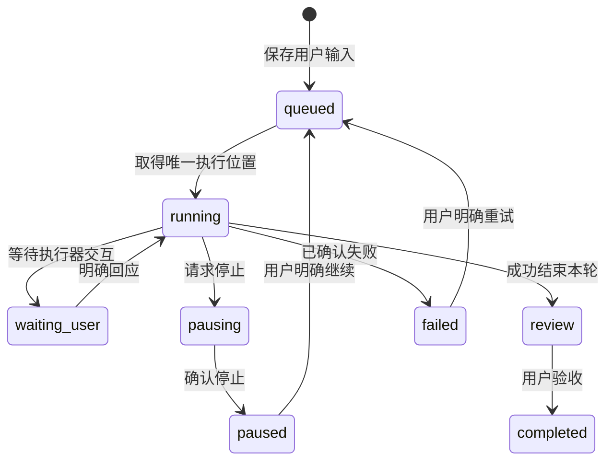
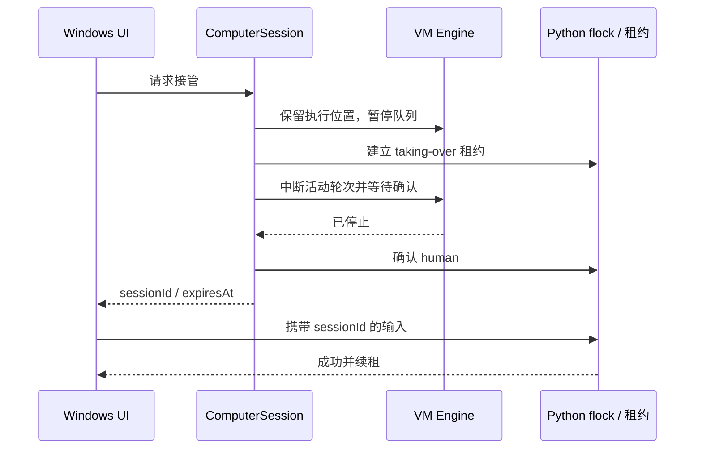

# dant Windows 实现架构

[English](../architecture.md) · 简体中文

实现依据为用户提供的 Mac / UTM 架构与 15 张界面参考。Windows 版本沿用职责划分，平台部分替换为 Hyper-V、AMD64 Ubuntu、OpenSSH 与 Windows 原生桌面宿主。

## 运行模式与数据归属

| 模式 | 职责 |
| --- | --- |
| `--prepare` | 界面与安装准备，不自动连接 VM 或启动模型 |
| 默认 / `--vm-controller` | Hyper-V 准备、部署、Windows 通知、离线缓存、工作 API 代理 |
| `--vm-worker` | VM 内普通用户运行，持有 Engine、Store、Codex、附件、记忆和桌面控制 |
| `--deploy-worker` | 仅部署或更新执行器，不启动本机界面 |

Controller 不创建任务 Engine，也不在 Windows 执行用户任务。Worker 启动时核验 Linux 虚拟环境、普通用户和图形桌面。两端 HTTP 服务只监听各自 loopback；VM API 不暴露到虚拟网卡，文件通过受控接口显式传递，不建立宿主目录共享。

Windows 保存 `controller.json`、`vm.json`、部署及迁移记录、`notifications.json`、加密的可选 API Key 和 `state-cache.json`。后者仅供断线展示，不成为新的对话存储。断线保留最后已知聊天和输入草稿，工作请求明确失败，不切换到宿主执行。

外观与语言属于 Controller 配置，离线也可更改。主题通过 CSS 颜色变量和原生窗口主题同步，字体包含中英文回退，不改变 VM 桌面的截图颜色。已运行过的有效连接目录登记在当前 Windows 用户的本地配置索引中；缺少绑定的安装版可以导入唯一有效来源，多个来源要求选择。导入只保存 SSH 连接资料，已有有效绑定不被自动替换；私钥仍保留原路径，虚拟磁盘和认证文件不移动。

VM 保存 `~/dant/data/state.json`、`attachments/<UUID>.bin` 与元数据、`memory/dant/`，工作现场为 `~/dant/workspaces/<conversationId>/output/`。首次迁移保留 Windows 原始数据备份，转换附件引用；不复制 Codex 认证文件。部署只同步源码允许列表，保留工作数据和版本备份，活动任务期间推迟更新。

## 持续对话和执行

唯一 `conversationId` 为永久 UUID，对应固定工作目录并复用 Codex 线程。用户消息先保存送达时间，`turn/start` 返回有效轮次 ID 后才标记执行器已确认。提前到达的轮次事件受数量和大小限制，确认后只重放匹配 ID 的事件。

`review`、`completed` 和“已读”各有独立含义。助手结果只有在页面可见、有焦点且进入视口持续约 450 ms 后才标为已读。普通成功轮次生成 Completion，供宿主延迟三秒检查未读并投递固定内容通知。

补充指令在已确认运行轮次上通过 `turn/steer` 与 `expectedTurnId` 串行提交。等待启动回执时先排队。未知提交结果被暂停，不自动重发。重启遗留运行、暂停中、等待决定及排队工作保留为暂停，避免无意重放外部操作。

## 文件与记忆

附件最多五个、每个 10 MiB；后端根据内容识别媒体格式，按 UUID 存储，不信任客户端 MIME 或原文件名路径。活动 HTML / SVG 作为下载，远程图片不自动加载，收到音频不自动播放。

每轮工作前计算 `output/` SHA-256 基线，成功后归档新增或变化文件；明确引用可再次交付已有文件。交付保存独立副本，后续修改原件不改变消息附件。扫描限制为 512 项、64 MiB、八层，拒绝符号链接、多硬链接、秘密及日志文件名；Linux 扫描以目录文件描述符锚定子路径，检查读前读后 inode 与状态。

记忆为 `README.md`、`identity.md`、`working-memory.md`，单文件上限 64 KiB，模型上下文上限 12,000 字符。记忆内容经过基础凭据脱敏和边界转义，只作参考数据，不能授予新权限。它与 ChatGPT 云端记忆独立。

## 桌面互斥

模型 Python 工具与人工输入共享 `flock` 和控制文件。接管停止未确认时不开放输入；旧会话 ID、未确认租约及过期租约均拒绝。两分钟没有输入则释放，交还后由用户明确继续已暂停任务。电脑面板仅在可见时串行取截图，并按实际图片区域换算坐标。

互斥约束覆盖应用调度及桌面工具，不能保证此前启动的独立后台进程停止，也不能代替 VM 的操作系统权限隔离。

## 语音

默认订阅通道使用 `thread/realtime/start`、`version: v3`、`gpt-live-1-codex` 与 WebRTC。前端拥有音轨和 `oai-events` 数据通道；Controller 和 VM 只传递协商与工作控制。实际媒体连接确认后才记录通话开始，单有 SDP 不算接通。

通话共享当前聊天线程和 VM 工作现场；明确交付的消息与文件进入聊天，语音转写不作为普通消息保存。停止同时处理音频与后台工作，无法确认的委派需要确认旧执行器退出，不能只因音频关闭就释放工作位置。

可选独立 API 通道显式启用，使用单独 API 费用。Key 只在 Windows DPAPI 持久化，经 SSH 短时交给 VM 通话进程使用。听写、浏览器朗读和本地 WAV 语音文件属于独立辅助通路。

## 平台差异与验证边界

Telegram 网关与 Worker 同进程运行，默认关闭。通过固定 Telegram HTTPS API 长轮询，不要求公网入站端口。首次设置生成短时一次性配对码，绑定私聊的用户与聊天 ID；群聊和未配对用户不能创建任务。Telegram 输入有稳定外部消息 ID，与桌面共用 Store 和串行 Engine；只回传来自该 Telegram 任务的完成消息和受控附件，不广播其他桌面任务或历史聊天。

Bot Token 单独保存在 VM 用户数据目录的受限文件中，不进入状态快照、离线缓存、记忆或聊天。外发请求未获明确结果时记录未知状态，不盲目重发。VM 重启保留偏移和去重信息，但不会自动恢复执行先前被暂停的任务。完整配对和故障处理见 [Telegram 接入](TELEGRAM.md)。

Windows 版保留现有 Express、WebSocket、Vite 等依赖，没有为了追求 Mac 原型的零 npm 依赖重写网络栈。浏览器默认 SSE，桌面 JSON 请求经 Rust IPC，状态在上次请求结束约 700 ms 后再轮询；Controller 合并 VM 状态读取，缓存窗口两秒。请求失败不会自动重发业务操作。

自动测试使用隔离数据目录、模拟执行器及 loopback 服务，验证回执时序、未知结果、数据迁移、归档、租约和传输。真实 VM 模型回复、桌面操作、附件以及 V3 静默 WebRTC 连接另行验收。真人麦克风、扬声器、连续语音打断和系统通知横幅必须与协议测试区别看待。
