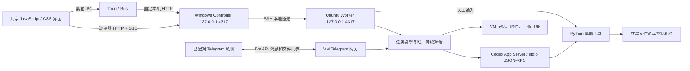
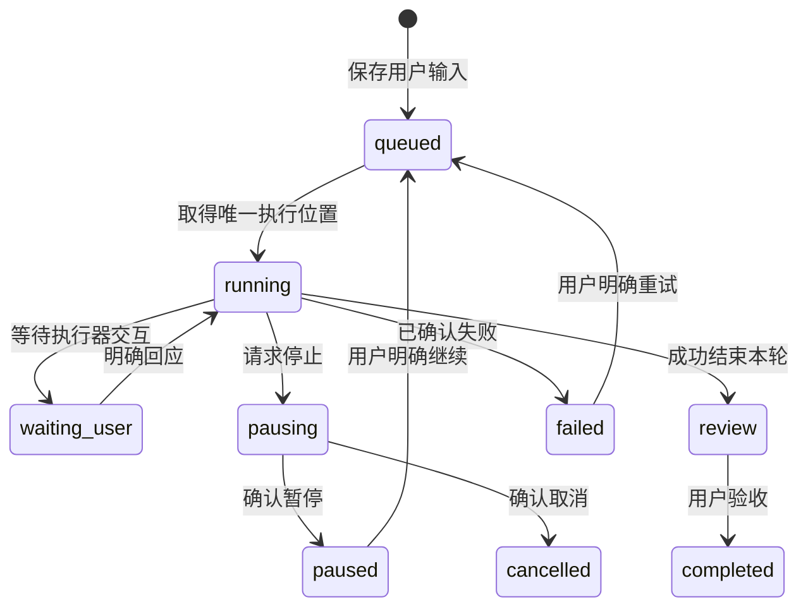
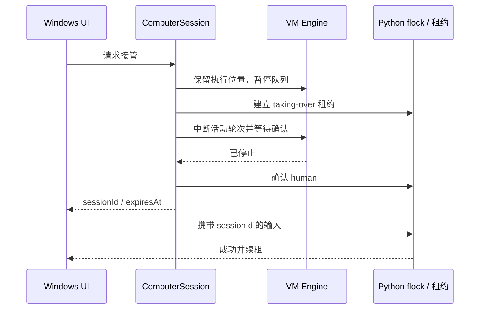

# dant Windows 实现架构

[English](../architecture.md) · Chinese

实现依据为用户提供的 Mac / UTM 架构与 15 张界面参考。Windows 版本沿用职责划分，平台部分替换为 Hyper-V、AMD64 Ubuntu、OpenSSH 与 Windows 原生桌面宿主。

## 运行模式与数据归属

| 模式 | 职责 |
| --- | --- |
| `--prepare` | 界面与安装准备，不自动连接 VM 或启动模型 |
| 默认 / `--vm-controller` | Hyper-V 准备、部署、Windows 通知、离线缓存、工作 API 代理 |
| `--vm-worker` | VM 内普通用户运行，持有 Engine、Store、Codex、附件、记忆和桌面控制 |
| `--deploy-worker` | 仅部署或更新执行器，不启动本机界面 |

Controller 不创建任务 Engine，也不在 Windows 执行用户任务。Worker 启动时核验 Linux 虚拟环境、普通用户和图形桌面。两端 HTTP 服务只监听各自 loopback；VM API 不暴露到虚拟网卡，文件通过受控接口显式传递，不建立宿主目录共享。

Windows 保存 `controller.json`、`vm.json`、部署及迁移记录、`notifications.json`、加密的可选 API Key 和 `state-cache.json`。后者仅供断线展示，不成为新的对话存储。断线保留最后已知聊天和输入草稿，工作请求明确失败，不切换到宿主执行。

外观与语言属于 Controller 配置，离线也可更改。主题通过 CSS 颜色变量和原生窗口主题同步，字体包含中英文回退，不改变 VM 桌面的截图颜色。已运行过的有效连接目录登记在当前 Windows 用户的本地配置索引中；缺少绑定的安装版可以导入唯一有效来源，多个来源要求选择。导入只保存 SSH 连接资料，已有有效绑定不被自动替换；私钥仍保留原路径，虚拟磁盘和认证文件不移动。

VM 保存 `~/dant/data/state.json`、`attachments/<UUID>.bin` 与元数据、`memory/dant/`，工作现场为 `~/dant/workspaces/<conversationId>/output/`。首次迁移保留 Windows 原始数据备份，转换附件引用；不复制 Codex 认证文件。部署只同步源码允许列表，保留工作数据和版本备份，活动任务期间推迟更新。

Windows 应用更新为正式版和 Beta 分别查询元数据，原生后台下载使用独立通道。原生程序读取固定、已认证的 Controller 描述，只接受官方安装包并校验大小和摘要。安装前确认工作已暂停并取得短期 Controller 安装租约，在原生程序挂起所属 VM 时阻止新的变更请求。挂起期间延长租约，交给更新助手前重新计时。复制出的更新助手等待准确的父进程及自有 Controller 句柄退出，重新校验安装包，仅在获得授权后启动安装；准备失败时恢复所属 VM，但不会恢复已暂停任务。重新打开应用时检查配套服务。详见[版本与更新](updates.md)。

## 持续对话和执行

唯一 `conversationId` 为永久 UUID，对应固定工作目录并复用 Codex 线程。用户消息先保存送达时间，`turn/start` 返回有效轮次 ID 后才标记执行器已确认。提前到达的轮次事件受数量和大小限制，确认后只重放匹配 ID 的事件。

模型工具和 `dant_desktop` MCP 均提供 `task_plan {title, steps, workId?, status?}`，先保存公开计划，再返回确认。可选 `status` 只接受 `running` 或 `waiting_user`，省略时保留原有行为。明确的 `waiting_user` 表示任务确实缺少用户信息，至少须有一个待办步骤，且不得有正在执行的步骤，已全部完成的清单不能变成等待输入。共同指令要求已接受的实际委托都先登记，包括简单发送链接或文件；需要澄清时先记录等待状态，再询问。普通聊天和单纯询问进度不建新工作条目；相关补充明确复用真实返回的 `workId`，可以跨执行轮次接续，不猜测最近任务，无关的新工作另建记录。持久记录保留原任务身份、开始时间及所属轮次，使回复和结果回执不再生成重复任务。接续要求当前已确认的归属，原记录须处于进行中、等待回复或暂停状态；拒绝归属未知及其他正在执行的记录。

一句回复结束不等于任务完成。执行回合正常结束但计划步骤尚未做完时，任务仍为**进行中**；确实等待用户输入时显示**等待你回复**，完整计划且没有待回复的实际问题时才进入待验收。进度面板把进行中的工作与最近结果分开，不把轮次间隙伪装成仍有执行器运行。普通语音、转写收尾及对话工具不会闪出通用任务卡。重启将被打断的执行恢复为暂停，已保留的未完成计划仍可辨认；收起历史条目不改变执行或共享上下文。

Worker 维护一个未完成任务巡检器，每 30 秒检查，并在进度变化后合并安排约 5 秒的补查。只有已结束执行、仍为 `continuing` 且有真实未完成步骤（或真实观察到的无计划记录）才可接续；按优先级和到期时间选择一项，让真实用户输入与普通队列优先。任何异步操作前先持久保存归属申请，再实时读取线程，证明旧轮次结束、共享执行器空闲。发 RPC 前保存提交阶段，真实新轮次确认后先绑定原工作身份，再处理缓冲的工具请求。内部续作不伪造用户消息，不重新提交原附件。仍未完成时退避后再检查；连续三轮既没有公开计划进展、也没有符合条件的执行证据，则暂停并记录明确原因。成功进程的新输出可有限延长执行；重复不变的观察、失败操作和只有开始事件均不算推进。等待输入、暂停、取消、待验收、提交未确认及人工接管都不会自动重跑。

自动续作是实际执行路径，不是状态汇报作业。普通文字和明确交付先缓冲，不新增聊天、未读或完成记录；已保存计划全部完成、真正需要输入或执行失败时，才交付汇总结果。私有 MCP 投递策略查询沿用准确轮次归属，缓冲回执不会声称已发送；输入提醒在确认收到人的回答后可再次触发。Telegram 宣告完成前也核对关联的已保存工作。

原生通话在空闲执行器接续时保留媒体身份，归属预留保护同时到达的语音委派与准确轮次。上游 `turn/start` 可能把输入加入已在运行的原生轮次，因此竞争的委派或含糊确认不能作为绑定任务、打断该原生执行的依据；保留不确定申请且不自动重试。若已确认真实新轮次但绑定保存失败，会继续保留内存归属并准确停止该轮次，只有匹配的实际结束事件才能把申请收尾为暂停历史。关闭服务先清理巡检器，再处理执行器。这参考了 [OpenClaw 心跳机制](https://docs.openclaw.ai/gateway/heartbeat) 对定时检查、持久工作与串行执行的区分，不把无声回复等同于任务完成。

如果准确归属的执行事件先于计划到达，Worker 会保存没有步骤清单的临时任务，不编造完成比例。后续真实计划更新同一身份，也可通过明确匹配的 `workId` 原子接续原任务。兜底只保留实际执行这一事实，不读取命令参数、输出或推理；原生事件缩减大载荷后仍保留这一分类。未核实的任务不会因回合结束而完成。澄清等待需要明确更新为 `running` 或确认收到用户回复才能继续；旧操作结束、迟到的委派回执都不能清除新问题。澄清前登记属于模型指令，不会把每句话都自动分类成任务。

明确取消与可恢复的暂停分别处理。工作进度在确认前捕获所选任务、轮次和通话身份；只有确认中断后才标记为 `cancelled`，停止未确认时保持可见。已结束执行但未完成的记录也可取消，不影响其他正在运行的任务。历史保留计划、结果和优先级，旧计划更新不能恢复它，也不计入“清空已完成”。限定作用域的 `task_list {}` 工具只读任务身份与状态摘要，`task_cancel {workId}` 使用同一取消流程；取消自身执行时先确认请求，不在工具事件链内等待自身结束。取消不会结束通话音频，也不会清空其他排队工作。聊天保留正常回复和真实结果，不再额外插入固定停止提示或已取消任务的 Retry；取消历史留在工作进度中。

侧栏和 `schedule_list`、`schedule_save`、`schedule_delete` 模型工具共用 Worker 的定时任务服务，覆盖两种语音及 MCP。保存不会立即执行；单次任务使用准确时间点和 IANA 时区，重复任务在保存的时区计算五字段 Cron 的未来下一次时间。到期派发先原子保存领取记录及一条排队消息，再交给串行队列。离线重复任务只补一次，同一定时任务尚有未完成工作时不会重叠；重启保留领取记录，不重复派发。桌面创建使用稳定请求 ID 处理 HTTP 回执不确定，删除后保留请求墓碑。优先级只重排定时任务在队列中的位置，不改变普通消息位置、不抢占正在执行的工作。通话、人工接管和归属未确认会延后执行；移除定时条目不取消已派发的工作。

定向任务回复通过 `/api/messages` 携带 `workReply:{workId,turnId,conversationId}` 及稳定的客户端消息 ID。保存和实际派发前均核对准确任务归属；正在执行的匹配轮次接收精确后续输入，已结束的工作沿用自动续作的持久领取与轮次绑定流程，使用新的人类输入并正常回复聊天。其他工作不会误收这条回复。Worker 快照明确声明 `workReply` 和 `recurringSchedules` 能力；Controller 转发新操作前检查新鲜能力及 VM 身份，避免旧服务静默忽略新字段。

模型上下文窗口、token 计量和自动压缩由 Codex 管理。dant 不覆盖上下文窗口、最大输出 token 或压缩阈值，也不根据缩短后的界面聊天记录重建模型线程。通话中的文字消息、安全记忆及已启用技能描述不再使用额外的 dant 上下文字数预算。可选 API 语音同样由服务方管理 token/截断策略，并保留完整传入聊天参考；模型和服务本身的限制仍适用。补充的消息 ID/表情查找标签、存储校验及观察/控制队列上限各有用途，不会缩短 Codex 原始会话。

`review`、`completed` 和“已读”各有独立含义。助手结果只有在页面可见、有焦点且进入视口持续约 450 ms 后才标为已读。普通成功轮次生成 Completion，供宿主延迟三秒检查未读，并通知这次交付中最后一条已完成的助手消息。预览为最多 240 个 Unicode 字符的纯文本，只有附件时显示文件名。预览内容仅保留在内存中，通知送达不会把消息标为已读。

桌面及 Telegram 的普通消息采用交互投递：当前已确认任务能接收输入时，消息通过 `turn/steer` 直接补充该轮次。请求绑定接收时的 `expectedTurnId` 串行提交，待确认的消息 ID 去重，仅在执行器确认后记录送达回执。计划任务、明确恢复及内部语音任务仍保持独立排队语义。等待启动回执时先排队。订阅通话留下的后台任务可接收文字补充，保留交接及归属保护；附件仍排队。未知提交结果被暂停，不自动重发。重启遗留运行、暂停中、等待决定及排队工作保留为暂停，避免无意重放外部操作。

## 文件与记忆

附件最多五个、每个 10 MiB；后端根据内容识别媒体格式，按 UUID 存储，不信任客户端 MIME 或原文件名路径。活动 HTML / SVG 作为下载，远程图片不自动加载，收到音频不自动播放。

所有显式下载入口均为按钮，点击文件或图片下载不会让主 WebView 离开聊天。`GET /api/files/:id?download=1` 强制附件下载，普通图片、音频请求仍用于内嵌预览。Windows 原生下载命令仅允许主窗口调用，从固定且需认证的 Controller 接口读取最多 10 MiB，打开“另存为”，再原子保存完整内容。取消不会改动文件或聊天。浏览器路径读取相同内容，通过临时 Blob 下载后回收 URL。文件名保留实际扩展名：PNG 截图和独立的 JSON 运行报告是不同附件。

每轮工作前计算 `output/` SHA-256 基线，成功后归档新增或变化文件；明确引用可再次交付已有文件。交付保存独立副本，后续修改原件不改变消息附件。扫描限制为 512 项、64 MiB、八层，拒绝符号链接、多硬链接、秘密及日志文件名；Linux 扫描以目录文件描述符锚定子路径，检查读前读后 inode 与状态。

记忆为 `README.md`、`identity.md`、`working-memory.md`，单文件存储上限为 64 KiB。安全参考内容完整提供给模型，不再额外设置上下文字数预算。记忆内容经过凭据脱敏和边界转义，只作参考数据，不能授予新权限。它与 ChatGPT 云端记忆独立。

## 桌面互斥

模型 Python 工具与人工输入共享 `flock` 和控制文件。接管停止未确认时不开放输入；旧会话 ID、未确认租约及过期租约均拒绝。两分钟没有输入则释放，交还后由用户明确继续已暂停任务。电脑面板仅在可见时串行取截图，并按实际图片区域换算坐标。

已确认接通的通话可在人工接管时保持连接。Worker 暂停排队任务，并等待准确的活动轮次确认停止；人工输入仍须取得 VM 确认的控制租约。交还不会重跑已中断或排队的任务，可在原通话中发出新指令继续工作。连接中、停止中、恢复中或状态未确认时禁止开始接管；已有人工租约仍可交还。接管不会结束媒体连接。

互斥约束覆盖应用调度及桌面工具，不能保证此前启动的独立后台进程停止，也不能代替 VM 的操作系统权限隔离。

## 语音

默认订阅通道使用 `thread/realtime/start`、`version: v3`、`gpt-live-1-codex` 与 WebRTC。前端拥有音轨和 `oai-events` 数据通道；Controller 和 VM 只传递协商与工作控制。实际媒体连接确认后才记录通话开始，单有 SDP 不算接通。

通话共享当前聊天线程和 VM 工作现场；明确交付的消息与文件进入聊天，语音转写不作为普通消息保存。媒体关闭与明确中断工作分别处理：媒体分离未确认时，保持控制锁定并保留已知任务；真正无法确认任务归属时，仍使用受保护的执行器恢复流程。

应用内的迷你通话采用横条，头像在左。拖动非按钮区域可在应用内移动，状态刷新保留位置，调整窗口大小后限制在可见范围。Windows 桌面版通话时最小化主窗口，会在显示器工作区右下角出现可拖动、置顶的小通话条；恢复主窗口或结束通话后隐藏。第二个窗口只接收通话元数据，并把限定于当前通话的控制交回主窗口；媒体连接仍由主窗口持有。小窗不另开麦克风、音频流，也没有通用本地 API 或语音进程权限。

通话启动读取权威 Codex 会话文字与共享持久记忆。原生语音在关闭前写入 Codex 历史；通话内已完成的语音快照同时供文字任务使用。API 语音以不启动推理的方式注入，并另存私有 `state.voiceHistory`，因为 Codex 的公开任务投影不会返回原始注入条目；该字段不进入状态快照或可见聊天。记忆保存会刷新两个模型，已完成的文字回复也同步给实时 API 语音。排序及不重放规则见[共享上下文](context.md#语音与文字共享会话)。

`src/identity.mjs` 统一定义文字、订阅语音和可选 API 语音的助手身份，三个入口都把 dant 识别为助手，并保留用户独立的角色；VM 或操作系统账号名不代表真人用户姓名。原生语音适配器同时把身份传入真正的实时 `prompt` 和后台任务指令。保存的聊天角色与原生传输中的任务结果标记分别处理。各适配器保留连接、音频和工具路由逻辑。

通话中输入的文字直接作为当前语音对话的用户输入，保留稳定消息 ID，并带上完整引用及原说话者。`Engine.rememberCallInput` 先以参考数据追加到权威会话，不启动推理；订阅语音随后使用 `thread/realtime/appendText`，可选 API 语音使用确认接收的用户 `input_text` 条目，并由现有响应状态安排语音回答。打字本身不再独立调用 `turn/start` 或 `turn/steer`；实际执行通过同一语音任务交接。确认收到的通话文字使用 `accepted` 投递状态，不伪造已完成工作，真实后台计划仍单独记录。普通语音回答不再自动变成聊天最终回复，明确请求的实用文字和文件仍可交付。表情保持参考数据语义；上下文或输入投递未知时不自动重放。

模型通过 VM 工具选择对用户消息的表情，独立保存为 `assistantReaction` / `assistantReactionUpdatedAt`，不混入人工 `reactions`。界面为 dant 的徽章注明归属，不提供用户切换操作。同一 emoji 可以分别属于双方，助手表情不会被当作用户反馈；界面也不会根据消息文字猜测表情。

缩小到聊天和展开只改变通话视图，保留 Peer 连接、媒体、通话 ID 与计时。计时从确认连接的时间开始，本机断线或挂断时暂停，最终与已保存的通话记录同步。

可选独立 API 通道显式启用，使用单独 API 费用。Key 只在 Windows DPAPI 持久化，经 SSH 短时交给 VM 通话进程使用。听写、浏览器朗读和本地 WAV 语音文件属于独立辅助通路。

输入框麦克风录制 WebM 或 Ogg 语音文件，提供计时条、暂停/继续、本地预览和取消。点击“发送语音”后才上传并单独发送录音，保留原文字、附件和引用回复草稿。取消或录音失败会丢弃音频并释放麦克风音轨。“语音转文字”仍是附件菜单中的独立操作。

输入框录音、上传音频和 Telegram 语音共用后台识别入口。提交任务前，`Engine.prepareInput` 通过 `AudioTranscriber` 调用 `AttachmentStore.read` 读取不可变附件、验证内容哈希，并在 VM 内识别语音。识别结果作为当前用户的讲话，连同文字说明及其他附件送入原 Codex 线程；不会新增可见文字气泡、记忆文件、诊断日志或独立转写缓存。原始语音及其播放、下载保持不变。与文字输入一样，识别内容会进入私有模型会话上下文。

`vm/install-transcription.sh` 在 `~/dant/runtime/transcription` 安装独立、固定版本的 `faster-whisper` 和多语言 small 模型，下载验证包与模型哈希。依赖锁定 Ubuntu 24.04 的 Python 3.12 / x86_64；其他来宾环境即使无法准备本地识别，文字与通话仍可使用。识别使用本地模型、CPU int8 和两个线程，不调用云端转写接口，也不需要额外 API Key。首次准备 VM 需要联网下载依赖，其中模型约 484 MB。识别进程串行执行，可取消、有执行超时，并在原有 10 MiB 附件限制之外限制解码音频为十分钟；超长会明确失败，不会悄悄截断。静音、损坏音频、依赖缺失或识别失败时，不会只把二进制路径交给模型猜测。用户暂停会在推理提交前取消准备；模型提交结果未知时仍不自动重放。

正常挂断只结束音频连接，已确认接收的任务继续在同一个 Codex 会话中执行。原生通话在分离音频后保留已确认任务的观察器；可选 API 通话的任务仍由原 Engine 执行。结果、错误及需要你回答的问题会发到聊天中，并保留未读状态。登录凭据请求继续显示在安全表单里。显式停止工作仍会中断任务；任务归属或停止状态无法确认时，仍执行原有的保守恢复规则。

已确认的任务运行时，也可以开始新的原生通话。媒体连接身份与任务、轮次和凭据的稳定归属分别管理；既有任务不会因此暂停或重复提交。Codex 将语音交给实际当前轮次来开始或调整执行。只有媒体握手通知能绕过被阻塞的工作事件链，任务与交接通知仍保持原顺序。连接失败时保留工作；媒体关闭未确认时，不会误报成功或终止任务。上一通话的过时控制不能挂断新通话。

明确发送的模型文本引用当前输出文件时，会通过原有受限归档器仅处理链接指向的文件，把不可变附件精确加入同一条消息，并保留已验证的来源路径用于匹配。桌面中的本地链接只能打开该消息唯一匹配的归档附件；无法匹配的旧路径提示重新发送，不保留可跳转系统的链接。Telegram 按实际内容把符合限制的 PNG/JPEG 作为照片发送，其他格式保留文档。只有明确的照片拒绝才能回退原文件；发送成功必须带有效消息 ID，回执不确定或 HTTP 5xx 不能触发重放。

## Telegram

Telegram 网关与 Worker 同进程运行，默认关闭。通过固定 Telegram HTTPS API 长轮询，不要求公网入站端口。首次设置生成短时一次性配对码，绑定私聊的用户与聊天 ID；群聊和未配对用户不能创建任务。Telegram 输入有稳定外部消息 ID，与桌面共用 Store 和串行 Engine，每条指令只进入任务引擎一次。配对私聊同步桌面新发的用户消息、已完成的助手消息和受控附件，Telegram 原始输入不回传。配对或升级时用配对周期标记已有消息，不批量导出历史；持久化消息标记和有界外发队列用于防止重启后重复发送，旧配对账号的任务结果不会发送给新账号。编辑、删除、引用回复关联和 reaction 不在当前同步范围内。

已配对账号可通过 `/status` 和 `/progress`（别名 `/porgress`）查看共享工作状态。`/pause` 使用共享的确认中断流程，不结束通话媒体；`/resume` 选择已知暂停消息任务，保留归属、通话和人工控制检查，候选不唯一时须给出完整任务 ID。原有 `/stop` 仍只控制本 Telegram 的任务。命令不会建立第二个执行器或重建上下文。

Bot Token 单独保存在 VM 用户数据目录的受限文件中，不进入状态快照、离线缓存、记忆或聊天。外发请求未获明确结果时记录未知状态，不盲目重发。VM 重启保留偏移和去重信息，但不会自动恢复执行先前被暂停的任务。完整配对和故障处理见 [Telegram 接入](TELEGRAM.md)。

Telegram 的当前连接错误与历史投递记录使用独立字段。已连接、已配对仍可同时存在旧的未确认消息；公开投递摘要只包含数量、最新时间和白名单原因。私有外发队列保存有限的传输分类，不保存原始异常细节。轮询恢复确认后清除当前连接错误，不删除投递历史或重新发送消息。

## 平台差异与验证边界

Windows 版保留现有 Express、WebSocket、Vite 等依赖，没有为了追求 Mac 原型的零 npm 依赖重写网络栈。浏览器默认 SSE，桌面 JSON 请求经 Rust IPC，状态在上次请求结束约 700 ms 后再轮询；Controller 合并 VM 状态读取，缓存窗口两秒。请求失败不会自动重发业务操作。

自动测试使用隔离数据目录、模拟执行器及 loopback 服务，验证回执时序、未知结果、数据迁移、归档、租约和传输。真实 VM 模型回复、桌面操作、附件以及 V3 静默 WebRTC 连接另行验收。真人麦克风、扬声器、连续语音打断和系统通知横幅必须与协议测试区别看待。
